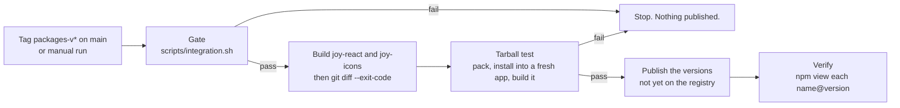

# Publish joy-design packages to GitHub Packages under @montionugera

<div class="callout info">
<strong>In one line:</strong> make the React-facing packages of this design system installable from a registry, so a project outside this repo can use them without copying files. The first consumer is the docs portal in the sibling repo <code>cli-state-handler</code> (its idea I-038).
</div>

## Problem

Nothing in this repo is published. A project that wants the design system has two options today: live inside this workspace, or keep a hand-copied ("vendored") copy, which is what `asset-studio` does for the Svelte and tokens packages. A copy drifts from the source and nobody is told when it does.

The React packages are also not in a publishable state:

- `@joymify/react` and `@joymify/icons` export TypeScript source (`main` points at `./src/index.ts`). A consumer would have to compile files inside `node_modules`.
- No package has `publishConfig`, `repository`, `license` or a `files` allowlist, so a publish today would ship tests and build scripts.
- The package scope is `@joymify`. GitHub Packages only accepts a scope that matches the owning account, and the owner decided (2026-10-09) to publish under the personal account `montionugera`, the same place `@montionugera/zen-ui` lives.

## Why now

The docs portal in `cli-state-handler` (React 19, Vite) was built with its own hand-written styles. The owner wants it rebuilt with the Joymify React components, installed from a registry, not copied. That work (cli-state-handler I-038, planned for its release 1.9) cannot start until these packages exist on the registry.

## Decisions already made by the owner

| Decision | Choice |
| --- | --- |
| Registry | GitHub Packages (`https://npm.pkg.github.com`) |
| Scope | `@montionugera` |
| Consumer uses | the full React component package, not only the stylesheet |
| Distribution | publish first; no vendored copy, no link to a sibling checkout |

## Scope

**In scope:** four packages that a React consumer needs.

| Today | Published name | Ships |
| --- | --- | --- |
| `@joymify/tokens` | `@montionugera/joy-tokens` | the existing built `dist/` (CSS variables, component CSS, Tailwind theme, JS token map) |
| `@joymify/icons` | `@montionugera/joy-icons` | built `dist/` for the React entry (`./react`); the Svelte entry (`.`) as source, as today; `PROVENANCE.md` |
| `@joymify/brand` | `@montionugera/joy-brand` | `src/` (plain JavaScript plus its `index.d.ts`) and `assets/`, as they are |
| `@joymify/react` | `@montionugera/joy-react` | built `dist/` (JavaScript plus type declarations) |

**Renamed but not published:** `@joymify/svelte` becomes `@montionugera/joy-svelte` so the workspace has one scope, and is marked `"private": true`. Publishing it needs a Svelte packaging step and has no consumer asking for it yet.

**Out of scope:** changing any component's look or behaviour; the Flutter package; migrating `asset-studio` off its vendored copy (it keeps working, because its copy has its own `@joymify/*` names); the restyle of the docs portal itself.

## Approaches considered

1. **Rename in source (chosen).** Change the package names and every import in this repo. One name everywhere: what the source says is what a consumer installs. Cost: a mechanical edit of about 122 source imports, 12 `package.json` entries, a handful of name strings in test helpers and build scripts, and the live docs.
2. **Rename only at publish time.** Keep `@joymify/*` in the workspace and have a script rewrite names into a staging folder before publishing. Smaller diff, but every reader would have to hold two names for one package, and the rewrite step is one more thing that can be wrong only in the published copy.
3. **Aliases.** Publish under `@montionugera` and have each consumer alias the names back to `@joymify/*`. Pushes permanent configuration onto every consumer to hide a rename we can simply do once.

Approach 1 keeps one set of names. It does not by itself prove the built output works: today's tests load `src/` directly and nothing loads `dist/`. That gap is closed by the scripted tarball test in section 4.

## Delivery in two phases

The rename and the build-and-publish work are independent. They ship as one feature in two phases, each with its own verify and review gate, and the rename lands first so a problem in one cannot hide in the other.

## Design

### Phase 1: Rename

- `name` in the five `packages/*/package.json` files, and every `workspace:*` reference between them. Then regenerate `pnpm-lock.yaml` (the gate installs with `--frozen-lockfile`, so a stale lockfile fails it).
- Every import of the old names in `packages/`, `apps/` and `scripts/`.
- Name strings that are not imports, which a search-and-replace on import statements misses:
  - the package-id literals in `packages/react/test/helpers/load-tsx.js` and its copy in the Svelte package (if missed, the helper silently falls through to `dist`);
  - the tokens lookup by name in `packages/brand/build.js`;
  - the Playwright assertions in `apps/storybook-hub/tests/contracts.spec.ts` and `framework-switcher.spec.ts`;
  - the README assertion in `scripts/test/docs-contract.test.mjs`.
- Live documentation: `README.md`, `AGENTS.md`, `PRODUCT.md`, and the generator `scripts/design-md/render.mjs` (then regenerate `DESIGN.md`; never hand-edit it).
- Not changed:
  - historical records under `.claude/` and `docs/superpowers/`;
  - the fictional example consumer `@joymify/quant` in `apps/storybook-hub/build.js`, which is sample text, not one of our packages;
  - CSS names. The `--joy-*` variables and `.joy-*` classes are the public styling contract and stay exactly as they are.

**Done when** a search for `@joymify/(tokens|icons|brand|react|svelte)` outside `.claude/`, `docs/superpowers/`, `node_modules`, `dist` and `graft` returns nothing, and `scripts/integration.sh` passes.

### Phase 2, part 1: Build output for `joy-react` and `joy-icons`

Use the TypeScript compiler that is already a dependency; add no bundler.

- `joy-react` gets a `tsconfig.build.json` that extends its existing config with `noEmit: false`, `allowImportingTsExtensions: false` (the compiler refuses to emit while that option is on; no import in `src` uses a `.ts` extension, so turning it off changes nothing else), `outDir: dist`, `declaration: true`, ES module output, and excludes tests and stories. Relative imports already use `.js` extensions, so emitted files resolve without rewriting.
- `joy-icons` gets the same, limited to its React entry: `src/react.ts` and `src/react/`. Its Svelte entry (`src/index.ts`, which re-exports 138 `.svelte` files) cannot be compiled by the TypeScript compiler and is not built; it keeps shipping as source, which is the normal form for Svelte components.
- Each gets a `build` script (`tsc -p tsconfig.build.json`).
- `main`, `module`, `types` and `exports` of `joy-react`, and the `./react` export of `joy-icons`, point at `dist/`. The `.` export of `joy-icons` is unchanged.
- `dist/` stays untracked for these two packages. Tokens' committed `dist/` is an existing choice and is left alone.

**Inside the workspace:** tests keep loading `src/` through their existing helpers, and the Storybook hub reads package sources by relative path, so neither needs `dist/`. The one thing that does is `joy-react`'s type-check, which reads `joy-icons`' declarations: it works when run through `turbo` (which builds dependencies first) and fails when run directly with `pnpm --filter` on a clean checkout. The plan must add the build as a `turbo` dependency of `check` and say so in `AGENTS.md`.

**First tasks of the plan (prove before building on them):** run the declaration build of `joy-react` once and record any errors that only appear with `declaration: true`, since type-checking with `noEmit` never exercised them across its 103 files.

### Phase 2, part 2: Package metadata

Each published package gets:

- `"publishConfig": { "registry": "https://npm.pkg.github.com" }`
- `"repository": { "type": "git", "url": "git+https://github.com/montionugera/joy-design.git", "directory": "packages/<name>" }` (this links the package to this private repo)
- a `files` allowlist, which must cover every path in that package's `exports`:

| Package | `files` |
| --- | --- |
| `joy-tokens` | `dist` |
| `joy-icons` | `dist`, `src/index.ts`, `src/index.d.ts`, `src/*.svelte`, `PROVENANCE.md` |
| `joy-brand` | `src`, `assets` |
| `joy-react` | `dist` |

- **Licence.** `joy-icons` contains icons derived from Lucide (ISC) and Feather (MIT); its `PROVENANCE.md` carries the notices those licences require to travel with every copy, so that file ships and the field is `"license": "SEE LICENSE IN PROVENANCE.md"`. The other three hold only original work and are `"license": "UNLICENSED"` (private, proprietary; no licence file exists and none is being invented).
- `"sideEffects"`: `["**/*.css"]` for tokens, `false` for the others.

Versions stay hand-set. The first publish is `0.2.0` for tokens, brand and react, and `0.3.0` for icons (it is already at `0.2.0`).

### Phase 2, part 3: Publish workflow

A new `.github/workflows/publish.yml`, modelled on `zen-ui`'s:



- **Trigger:** a pushed tag matching `packages-v*`, or a manual run. Not every push to `main`: publishing is permanent, so it takes a deliberate act. The job refuses a tag whose commit is not on `main`.
- **Runner setup:** the gate calls `scripts/precheck.sh`, which needs Flutter, Playwright's Chromium and ripgrep and fails without them. The job repeats the setup steps of the existing `build` job in `.github/workflows/ci.yml`. It does not copy `zen-ui`'s lighter setup.
- **Build:** only `joy-react` and `joy-icons` are built here. Tokens is already rebuilt by the gate, and brand's build rewrites committed image files, so it is not run. `git diff --exit-code` after the gate and build fails the job if anything committed changed, so the bytes published are the bytes in git.
- **Tarball test (the check that the built output works):** a script, `scripts/test/consumer-smoke.sh`, packs the four packages, installs the tarballs into a fresh Vite + React 19 app created in a temporary folder outside the workspace, imports `theme.css`, renders `Button`, `Tabs`, one icon and `BrandMark`, and runs that app's type-check and build. It also runs locally, so it is the same check before and during publish.
- **Publish:** for each of the four names in dependency order (tokens, icons, brand, react), ask the registry whether `name@version` exists (`npm view`); if it does, skip it and say so; if not, `pnpm publish --no-git-checks` from that package's folder. `pnpm publish` replaces `workspace:*` with the real version in the published `package.json`; `npm publish` does not, so it must not be used.
- **Auth:** the workflow's own `GITHUB_TOKEN` with `packages: write`, the pattern `zen-ui` already uses. No new secret.
- **Dry run:** a `dry_run` input runs everything up to and including the tarball test, then `pnpm publish --dry-run`, and prints each tarball's file list.

### Phase 2, part 4: What a consumer does

Documented in `README.md` under a new "Install from the registry" section:

```ini
# .npmrc in the consuming repo
@montionugera:registry=https://npm.pkg.github.com
//npm.pkg.github.com/:_authToken=${GITHUB_TOKEN}
```

```ts
import '@montionugera/joy-tokens/theme.css';
import { Button, Tabs } from '@montionugera/joy-react';
```

Both the repo and its packages are private, so every install needs a token:

- **On a developer machine:** a personal GitHub token with the `read:packages` permission, exported as `GITHUB_TOKEN`.
- **In another repo's GitHub Actions:** that repo's automatic token cannot read these packages by default. Either each of the four packages is set (in its package settings on GitHub) to grant that repo access, or the consuming repo stores a personal token as a secret.

Fonts are still loaded by the consumer (see `DESIGN.md`).

## Error handling

| Situation | Behaviour |
| --- | --- |
| Gate or tarball test fails | Workflow stops before any publish. |
| Version already on the registry | That package is skipped and reported; the others still publish. |
| Publish succeeds for some packages and fails for others | Re-running is safe, because published versions are skipped. The fix is a re-run, never an unpublish. |
| A bad version is published | Publish a higher fixed version. A published version is not reused. |

## Acceptance criteria

- [ ] Phase 1: the search in "Done when" is empty and `scripts/integration.sh` passes.
- [ ] Phase 2: `scripts/test/consumer-smoke.sh` passes locally, with the temporary app having no path into this repo's source.
- [ ] Each tarball's file list matches the `files` table, contains no test or story files, and its `package.json` has concrete versions in place of `workspace:*`.
- [ ] The workflow's dry run passes on GitHub and shows the four packages in dependency order.
- [ ] After the real publish (separate go-ahead, see Risks): `npm view` returns the expected version for each of the four names, and the smoke app installs them from the registry and builds.

## Risks

<div class="callout danger">
<strong>Publishing is the irreversible step.</strong> Everything up to and including the dry run can be undone with a revert. The first real tag push cannot. It needs the owner's explicit go-ahead at that moment, separate from approval of this spec.
</div>

- **Blast radius of the rename:** every package in this repo refers to another by name, some of them in plain strings. A missed reference breaks the build or, in the test helper, silently changes what is tested. The explicit list in Phase 1 and the search check are the guard.
- **Deployed Storybook portal:** `apps/storybook-hub` is deployed from `main`. It reads package sources by relative path, so the rename affects its text and its Playwright assertions, not its resolution. It is rebuilt and smoke-checked by the existing CI on merge.
- **Vendored copies elsewhere:** `asset-studio` keeps `@joymify/*` names in its own copy. It is unaffected, and it will not receive this rename until someone re-syncs it.
- **Token on every consumer:** private GitHub Packages cannot be installed anonymously (see Phase 2, part 4).

## Follow-ups (not in this feature)

- Publish `joy-svelte` and move `asset-studio` from its vendored copy to the registry.
- `joy-icons` declares `react ^19` as a peer while `joy-react` allows `^18 || ^19`; align them.
- `packages/react/package.json` points `types` at a `src/index.d.ts` that does not exist; this feature replaces that entry with the built declarations.
- A versioning tool (for example Changesets) if hand-set versions become error-prone.

## Audit trail

Independent audit, 2026-10-09 (read-only, against the repo at `release/3.7`). No critical findings; six high findings, all applied (the two about the `files` allowlist are combined in the second point):

- The Svelte icon entry cannot be compiled by the TypeScript compiler: now stated as fact, built output limited to the React entry.
- The `files` allowlist did not cover the Svelte entry of `joy-icons` or the type declarations of `joy-brand`: per-package table added.
- `UNLICENSED` with a `dist`-only allowlist would have dropped third-party icon notices: `PROVENANCE.md` now ships with `joy-icons`.
- The publish gate needs Flutter, Playwright and ripgrep on the runner: setup now copied from the CI `build` job.
- Nothing automated loaded the built output: the tarball test is now a script run before every publish.

Medium findings applied: the emit option conflict in the build config; declaration build as a first task; the rename's done-criterion and its list of non-import name strings; lockfile regeneration; building only react and icons with a clean-tree check; consumer CI token access; an explicit registry check in place of an assumed skip behaviour. Scope kept as one feature in two gated phases.
