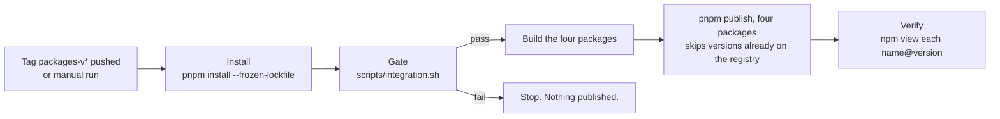

# Publish joy-design packages to GitHub Packages under @montionugera

<div class="callout info">
<strong>In one line:</strong> make the React-facing packages of this design system installable from a registry, so a project outside this repo can use them without copying files. The first consumer is the docs portal in the sibling repo <code>cli-state-handler</code> (its idea I-038).
</div>

## Problem

Nothing in this repo is published. A project that wants the design system has two options today: live inside this workspace, or keep a hand-copied ("vendored") copy, which is what `asset-studio` does for the Svelte and tokens packages. A copy drifts from the source and nobody is told when it does.

The React packages are also not in a publishable state:

- `@joymify/react` and `@joymify/icons` export TypeScript source (`main` points at `./src/index.ts`). A consumer would have to compile files inside `node_modules`.
- No package has `publishConfig`, `repository`, `license` or a `files` allowlist, so a publish today would ship tests, build scripts and `PROVENANCE.md`.
- The package scope is `@joymify`. GitHub Packages only accepts a scope that matches the owning account, and the owner decided (2026-10-09) to publish under the personal account `montionugera`, the same place `@montionugera/zen-ui` lives.

## Why now

The docs portal in `cli-state-handler` (React 19, Vite) was built with its own hand-written styles. The owner wants it rebuilt with the Joymify React components, installed from a registry, not copied. That work (cli-state-handler I-038, planned for its release 1.9) cannot start until these packages exist on the registry.

## Decisions already made by the owner

| Decision | Choice |
| --- | --- |
| Registry | GitHub Packages (`https://npm.pkg.github.com`) |
| Scope | `@montionugera` |
| Consumer uses | the full React component package, not only the stylesheet |
| Distribution | publish first; no vendored copy, no link to a sibling checkout |

## Scope

**In scope:** four packages that a React consumer needs.

| Today | Published name | Ships |
| --- | --- | --- |
| `@joymify/tokens` | `@montionugera/joy-tokens` | built `dist/` (CSS variables, component CSS, Tailwind theme, JS token map) |
| `@joymify/icons` | `@montionugera/joy-icons` | built `dist/` (React and Svelte icon entry points) |
| `@joymify/brand` | `@montionugera/joy-brand` | `src/*.js` and `assets/` as they are (already plain JavaScript) |
| `@joymify/react` | `@montionugera/joy-react` | built `dist/` (JavaScript plus type declarations) |

**Renamed but not published:** `@joymify/svelte` becomes `@montionugera/joy-svelte` so the workspace has one scope, and is marked `"private": true`. Publishing it needs a Svelte packaging step and has no consumer asking for it yet.

**Out of scope:** changing any component's look or behaviour; the Flutter package; migrating `asset-studio` off its vendored copy (it keeps working, because its copy has its own `@joymify/*` names); the restyle of the docs portal itself.

## Approaches considered

1. **Rename in source (chosen).** Change the package names and every import in this repo. One name everywhere: what the source says is what a consumer installs. Cost: a mechanical edit of about 122 source imports, 12 `package.json` entries and the live docs, all covered by the existing test suites.
2. **Rename only at publish time.** Keep `@joymify/*` in the workspace and have a script rewrite names into a staging folder before publishing. Smaller diff, but the published code would differ from the tested code, and every reader would have to hold two names for one package.
3. **Aliases.** Publish under `@montionugera` and have each consumer alias the names back to `@joymify/*`. Pushes permanent configuration onto every consumer to hide a rename we can simply do once.

Approach 1 is the only one where the thing tested is the thing shipped.

## Design

### 1. Rename

- `name` in the five `packages/*/package.json` files, and every `workspace:*` reference between them.
- Every import of the old names in `packages/`, `apps/`, and `scripts/` (source, tests, build scripts).
- Live documentation: `README.md`, `AGENTS.md`, `GEMINI.md`, `PRODUCT.md`, package READMEs, and the generator `scripts/design-md/render.mjs` (then regenerate `DESIGN.md`; never hand-edit it).
- Not changed: historical records under `.claude/idea_backlog/` and `.claude/refined_backlog/`, and CSS names. The `--joy-*` variables and `.joy-*` classes are the public styling contract and stay exactly as they are.

Done when a search for `@joymify/` outside `.claude/`, `node_modules`, `dist` and `graft` returns nothing, and `scripts/integration.sh` passes.

### 2. Build output for `joy-react` and `joy-icons`

Use the TypeScript compiler that is already a dependency; add no bundler.

- Each of the two packages gets a `tsconfig.build.json` that extends its existing config with `noEmit: false`, `outDir: dist`, `declaration: true`, `jsx: react-jsx`, ES module output, and excludes tests and stories. Relative imports already use `.js` extensions (93 of 93 in `packages/react/src/index.ts`), so emitted files resolve without rewriting.
- Each gets a `build` script (`tsc -p tsconfig.build.json`).
- `main`, `module`, `types` and `exports` are pointed at `dist/`. Inside the workspace, tests and Storybook keep working because `turbo` builds dependencies first; `scripts/integration.sh` gains the two builds before the test step.
- `dist/` stays untracked for these two packages (tokens' committed `dist/` is an existing choice and is left alone).

<div class="callout warn">
<strong>Unverified until built:</strong> whether the Svelte icon entry point of <code>joy-icons</code> can be compiled by <code>tsc</code> alone. If its Svelte components need the Svelte compiler, <code>joy-icons</code> publishes only the React entry (<code>./react</code>) from <code>dist/</code> and keeps exporting Svelte source as today. The plan must check this first.
</div>

### 3. Package metadata

Each published package gets:

- `"publishConfig": { "registry": "https://npm.pkg.github.com" }`
- `"repository": { "type": "git", "url": "git+https://github.com/montionugera/joy-design.git", "directory": "packages/<name>" }` (this links the package to this private repo)
- `"license": "UNLICENSED"` (private, proprietary; no licence file exists and none is being invented)
- a `files` allowlist: `dist` (plus `src/*.js` and `assets` for brand), excluding tests and stories
- `"sideEffects"`: `["**/*.css"]` for tokens, `false` for the others

Versions stay hand-set. The first publish uses `0.2.0` for all four, marking the rename.

### 4. Publish workflow

A new `.github/workflows/publish.yml`, modelled on `zen-ui`'s:



- **Trigger:** a pushed tag matching `packages-v*`, or a manual run. Not every push to `main`: publishing is permanent, so it takes a deliberate act.
- **Auth:** the workflow's own `GITHUB_TOKEN` with `packages: write`. No new secret.
- **Command:** `pnpm --filter` on the four package names, `publish --no-git-checks`. `pnpm publish` replaces `workspace:*` with the real version in the published `package.json`; `npm publish` does not, so it must not be used.
- **Dry run first:** the workflow accepts a `dry_run` input that runs `pnpm publish --dry-run` and `pnpm pack`, and prints each tarball's file list.

### 5. What a consumer does

Documented in `README.md` under a new "Install from the registry" section:

```ini
# .npmrc in the consuming repo
@montionugera:registry=https://npm.pkg.github.com
//npm.pkg.github.com/:_authToken=${GITHUB_TOKEN}
```

```ts
import '@montionugera/joy-tokens/theme.css';
import { Button, Tabs } from '@montionugera/joy-react';
```

Both the repo and its packages are private, so every install needs a GitHub token with the `read:packages` permission. Fonts are still loaded by the consumer (see `DESIGN.md`).

## Error handling

| Situation | Behaviour |
| --- | --- |
| Gate fails | Workflow stops before any publish. |
| Version already on the registry | `pnpm publish` skips that package; the others still publish. The verify step lists what is live. |
| Publish succeeds for some packages and fails for others | Re-running is safe (published versions are skipped). The fix is a re-run, never an unpublish. |
| A bad version is published | Publish a higher fixed version. A published version is not reused. |

## Verification

1. `scripts/integration.sh` passes after the rename and after the build repointing.
2. `pnpm pack` for each of the four: the tarball contains `dist/` (or brand's `src` and `assets`), no test or story files, and a `package.json` with concrete versions in place of `workspace:*`.
3. **Consumer smoke test before the real publish:** in a throwaway folder outside this repo, install the four tarballs into a fresh Vite + React 19 app, import `theme.css` and render `Button`, `Tabs` and one icon. It must build and type-check with no access to this repo's source.
4. After the real publish: `npm view @montionugera/joy-react@0.2.0` (and the other three) from a machine with a `read:packages` token, then repeat the smoke test installing from the registry.

## Risks

<div class="callout danger">
<strong>Publishing is the irreversible step.</strong> Everything up to and including the dry run can be undone with a revert. The first real tag push cannot. It needs the owner's explicit go-ahead at that moment, separate from approval of this spec.
</div>

- **Blast radius of the rename:** every package in this repo imports another by name, so a missed reference breaks the build. The existing suites and the search check in section 1 are the guard.
- **Deployed Storybook portal:** `apps/storybook-hub` imports the packages by name and is deployed from `main`. It is rebuilt and smoke-checked by the existing CI on merge.
- **Vendored copies elsewhere:** `asset-studio` keeps `@joymify/*` names in its own copy. It is unaffected, and it will not receive this rename until someone re-syncs it.
- **Token on every consumer:** private GitHub Packages cannot be installed anonymously. A consumer with CI needs a token secret there too.

## Follow-ups (not in this feature)

- Publish `joy-svelte` and move `asset-studio` from its vendored copy to the registry.
- A versioning tool (for example Changesets) if hand-set versions become error-prone.
