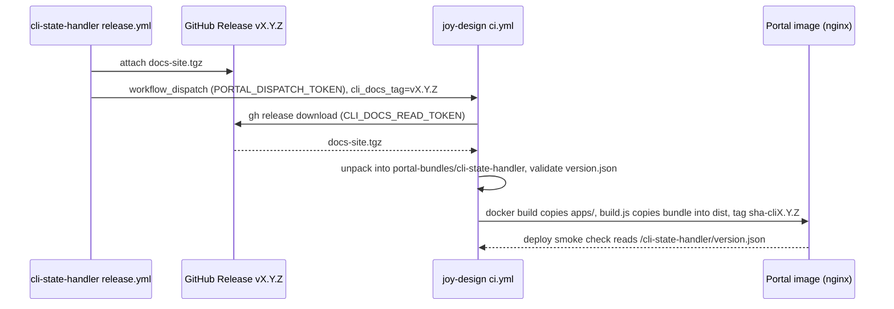

# Download cli-state-handler docs archive from its GitHub Release before the portal image build

## Summary

The developer portal (dev.joymify.com, built from this repository, joy-design) shows the documentation of
the `cli-state-handler` library under `/cli-state-handler/`. Today that documentation is a **copy committed
into joy-design**; nothing refreshes it. Meanwhile every `cli-state-handler` release already
packs its freshly built docs into a file, `docs-site.tgz`, and attaches it to a GitHub Release (the page
GitHub creates for a version tag such as `v0.2.0`).

This spec makes joy-design's CI (continuous integration, the GitHub Actions workflow `ci.yml`) **download
that file and unpack it just before the portal's container image is built**, so the portal always serves
the docs of a real, named release. Both repositories are private, so the download needs a credential: a
narrowly scoped, read-only token that the repository owner creates by hand. If the download cannot be done,
the build **fails loudly** instead of quietly shipping old docs. Local builds on a laptop are unchanged.

## Problem

- `apps/storybook-hub/portal-bundles/cli-state-handler/` is a tracked snapshot of 3 files (`index.html` plus
  one JS and one CSS file), last touched by commit `b6df3811` (release 3.6). `apps/storybook-hub/build.js`
  lines 14669-14681 copy it into `dist/cli-state-handler`, and `Dockerfile` line 11 runs that build. So the
  image serves **stale docs that look healthy**: `scripts/smoke-prod.sh` only checks for HTTP 200.
- `Dockerfile` line 21 (`mkdir -p .../cli-state-handler`) is a no-op once the snapshot is copied; the
  directory is empty only if the snapshot is ever deleted.
- `scripts/assemble-portal.sh` lines 50-68 copy from a sibling `cli-state-handler` checkout. Neither the
  `Dockerfile` nor `ci.yml` calls that script, and CI has no sibling checkout. It is a local-only helper.
- `cli-state-handler/.github/workflows/release.yml` line 140 builds the archive
  (`tar -czf "$RUNNER_TEMP/docs-site.tgz" -C apps/docs/dist .`) and lines 154-163 try to start joy-design's
  `ci.yml`, but the secret `PORTAL_DISPATCH_TOKEN` is not set (`gh secret list` shows none in that
  repository), so the step warns and exits 0: the exact failure mode this spec must not repeat.
- Nothing in joy-design downloads the Release asset. joy-design's own `GITHUB_TOKEN` (the automatic
  per-run credential) cannot read another private repository.
- Why now: v0.2.0 (the only GitHub Release so far) has `docs-site.tgz` (176 KB) attached and the signal
  step exists; the download is the missing half, and three sibling follow-ups touch the same workflows.

## Decisions already made (not reopened)

- The download runs in joy-design's CI, **before the image build**, using `gh release download` against
  `montionugera/cli-state-handler`.
- The credential is a fine-grained personal access token (a GitHub token limited to chosen repositories and
  permissions) with read-only **Contents** on `cli-state-handler`, stored as a joy-design Actions secret.
- Both tokens are created by the repository owner by hand (steps below). No automation creates secrets.
- Local builds keep working from the sibling checkout, then the tracked snapshot, exactly as today.

## Sketch

### Cross-repo flow

### Where the archive is fetched and unpacked

The archive has **no top-level folder**: its root is the content of `apps/docs/dist` (`./index.html`,
`./assets/...`, `./version.json`). The docs are built with Vite `base: "/cli-state-handler/"`, so they must
be served at exactly that path. Unpack target:
`apps/storybook-hub/portal-bundles/cli-state-handler/` in the CI workspace. The existing chain then does the
rest with **no Dockerfile change**: `COPY apps/ ./apps/` (line 7), `build.js` copies the bundle to
`dist/cli-state-handler` (line 11), nginx serves it (`nginx.conf` lines 50-56). This relies on the
"Build and push" step keeping `context: .` (the workspace); without it the action builds from a fresh git
checkout and the fetched files are ignored.

### The image tag must carry the docs version

`k8s/deployment.yml` sets no `imagePullPolicy`, and the deploy job pins the image to the 12-character
commit hash (`ci.yml` lines 139-144 and 221-227). For any tag other than `latest` Kubernetes then pulls
**only if the node does not already hold that tag**. A release-signalled run builds from an unchanged
joy-design commit, so it would reuse the previous tag: the node keeps its cached image, the old docs stay
live, and the registry copy of that tag is overwritten. Therefore the tag becomes
**`<12-char hash>-cli<X.Y.Z>`**, built from the version the fetch step resolved. Every docs version gets its own immutable tag, so rollout and rollback by `image_tag` are
exact. Rejected: `imagePullPolicy: Always` alone, because the tag would still be overwritten.

Files to change:

| File | Change |
| --- | --- |
| `scripts/fetch-cli-docs.sh` (new) | Check `GH_TOKEN` is non-empty itself (a laptop's stored `gh` login must not mask a missing token), download and unpack in a `mktemp -d` folder **outside the repository** (anything left under `apps/` would be copied into the image), validate, then replace the bundle folder. Takes an optional tag argument. Prints `cli-docs: fetched vX.Y.Z (version.json X.Y.Z)`. |
| `.github/workflows/ci.yml` | (1) new `workflow_dispatch` input `cli_docs_tag` (optional, default empty). (2) in job `build-push-image`, a step "Fetch cli-state-handler docs" after "Checkout" (line 126) and **before "Set image tag" (line 139)**, with `GH_TOKEN: ${{ secrets.CLI_DOCS_READ_TOKEN }}`, running the script and exporting the resolved version as job output `cli_docs_version`. (3) "Set image tag" appends `-cli<version>`. (4) job `deploy` passes `cli_docs_version` to the `dev.joymify.com` smoke call as `EXPECTED_CLI_DOCS_VERSION`. |
| `scripts/smoke-prod.sh` | When `EXPECTED_CLI_DOCS_VERSION` is set, fetch the **body** of `/cli-state-handler/version.json` and fail unless its `version` matches. Status alone proves nothing: nginx answers a missing file with `index.html` and HTTP 200. The check sits in the non-legacy branch (the `design.joymify.com` call exits at line 28). Unset (rollback by `image_tag`, or a deploy with no build) skips it. |
| `README.md` | See "README task". |

Not changed: `Dockerfile`, `nginx.conf`, `scripts/assemble-portal.sh`, `build.js`, the tracked snapshot
(it stays as the local fallback; CI overwrites it only inside the throwaway workspace, never commits it).

### Which release to fetch

| | Option A: always latest | Option B: tag input, latest as default (recommended) |
| --- | --- | --- |
| How | `gh release download` with no tag | `cli_docs_tag` input; empty means latest |
| Release-triggered run | May race: "latest" can lag or be a newer release than the one that signalled | Fetches exactly the release that signalled |
| Push to joy-design `main` | Latest | Latest (input is empty on push) |
| Roll docs back | Not possible without deleting a release | Re-run `ci.yml` with an older tag (usable from the second release; only v0.2.0 exists today) |
| Cross-repo coupling | None | One extra flag in `cli-state-handler` |

**Recommendation: Option B.** It is deterministic for the run that matters and gives a rollback lever for
one optional input. Matching change, a **separate follow-up owned by `cli-state-handler`** (another session
is editing that workflow now; not specified here beyond the line): `release.yml` line 163 passes
`-f cli_docs_tag=v$VERSION`. Ordering constraint: joy-design must ship the input **first**, because GitHub
rejects a dispatch carrying an input the target workflow does not declare. Until the follow-up lands, the
signal arrives without the input and joy-design fetches latest, which is correct in the normal case.
Note for that follow-up: the signal step (line 155) runs even when the tag check (line 128) found no tag,
so it could name a release that does not exist; joy-design then fails loudly, as designed below.

### Failure behaviour

The fetch step runs only in `build-push-image`, which runs only on push to `main` or on a manual or
signalled `workflow_dispatch` without `image_tag`. It never runs on pull requests.

| Case | Behaviour | Why |
| --- | --- | --- |
| `CLI_DOCS_READ_TOKEN` empty or missing | **Fail** with `::error::` naming the secret | A permanent misconfiguration; a warning was ignored once already |
| Token rejected (expired, revoked, wrong scope) | **Fail** | Same; expiry must be visible on the day it happens |
| Requested tag has no release, or release has no `docs-site.tgz` | **Fail** | The caller asked for docs that do not exist |
| No release at all when resolving latest | **Fail** | Cannot name the version being served |
| Network or server error | Retry 3 times, 10 s apart, then **fail** | Transient errors should not need a human; persistent ones should |
| Archive unpacks without `index.html` or `version.json`, or `version.json` differs from the requested tag | **Fail**; the bundle folder is left untouched | Validation happens in a temporary folder before the swap, so a bad archive never reaches the image |
| Pull request builds | Step does not run; tracked snapshot is used | No image is published from pull requests |
| Local `docker build` / `assemble-portal.sh` | Unchanged: `docker build` uses the snapshot; the script uses sibling checkout, then snapshot, then stub | Laptops have no token |

There is deliberately **no "skip" switch**. A failed fetch blocks new portal images until fixed; the live
portal keeps running the previous image, and `workflow_dispatch` with `image_tag` still redeploys any
existing image without building.

## Manual steps for the repository owner

`montionugera` is a personal account, not an organization, so both tokens must be created while signed in
**as `montionugera`** (a collaborator account cannot create a fine-grained token for these repositories).
Path: GitHub Settings, Developer settings, Personal access tokens, Fine-grained tokens, Generate new token.

1. Token "joy-design reads cli docs": resource owner `montionugera`; repository access "Only select
   repositories" = `cli-state-handler`; repository permission **Contents: Read-only** (Metadata: Read-only
   is added automatically); nothing else. Save it as Actions secret **`CLI_DOCS_READ_TOKEN`** in
   **`montionugera/joy-design`** (Settings, Secrets and variables, Actions, repository secret).
2. Token "cli-state-handler signals portal": resource owner `montionugera`; only repository `joy-design`;
   repository permission **Actions: Read and write**; nothing else. Save it as Actions secret
   **`PORTAL_DISPATCH_TOKEN`** in **`montionugera/cli-state-handler`**.
3. Set an expiry and a calendar reminder for both; an expired token fails the build by design.

Permission check (confirmed against GitHub's "Permissions required for fine-grained personal access tokens"
reference): `POST /repos/{owner}/{repo}/actions/workflows/{workflow_id}/dispatches` is listed under
repository permission "Actions" at **write**, so the handoff's "Actions: Read and write" is correct.
The release and release-asset read endpoints are listed under "Contents" at **read**.

## Security notes

- Each token covers one repository and the minimum permission; the docs token cannot write anything.
- The token is passed only as `GH_TOKEN` in the environment of the single fetch step. It is **not** a Docker
  build argument, not a build secret, and not in the build context: the image build only sees unpacked
  static files, so the token cannot land in an image layer or the build cache.
- The script never prints the token and does not enable shell tracing (`set -x`).
- GitHub does not pass secrets to workflows triggered by pull requests from forks, and the step's job does
  not run on `pull_request` at all.
- The archive is unpacked with `tar --no-same-owner` into a fresh temporary folder; entries with absolute
  paths or `..` are rejected before the swap.

## Acceptance criteria

- [ ] `gh secret list -R montionugera/joy-design` lists `CLI_DOCS_READ_TOKEN`, and
  `gh secret list -R montionugera/cli-state-handler` lists `PORTAL_DISPATCH_TOKEN`.
- [ ] Local, with a token in `GH_TOKEN`: `bash scripts/fetch-cli-docs.sh v0.2.0` exits 0, prints
  `cli-docs: fetched v0.2.0 (version.json 0.2.0)`, and
  `cat apps/storybook-hub/portal-bundles/cli-state-handler/version.json` prints `{"version":"0.2.0"}`.
  (This rewrites tracked files locally; do not commit them. Restore with
  `git checkout -- apps/storybook-hub/portal-bundles && git clean -fd apps/storybook-hub/portal-bundles`
  after the image check below.)
- [ ] `GH_TOKEN= bash scripts/fetch-cli-docs.sh` exits non-zero, prints an `::error::` line naming
  `CLI_DOCS_READ_TOKEN`, and `git status --short apps/storybook-hub/portal-bundles` prints nothing (run it
  on a machine where `gh auth status` is logged in, to prove the stored login is not used).
- [ ] `bash scripts/fetch-cli-docs.sh v9.9.9` exits non-zero and leaves the bundle folder unchanged.
- [ ] Image check after a successful local fetch: `docker build -t portal-test . && docker run -d -p 8080:80
  portal-test`, then `curl -s localhost:8080/cli-state-handler/version.json` prints `{"version":"0.2.0"}`
  and `curl -s -o /dev/null -w '%{http_code}' localhost:8080/cli-state-handler/` prints `200`.
- [ ] `docker history --no-trunc portal-test | grep -ci 'github_pat\|GH_TOKEN'` prints `0`.
- [ ] CI (**this run deploys to production**; a dispatch always runs the `deploy` job, so get the owner's
  go-ahead first): `gh workflow run ci.yml -R montionugera/joy-design --ref main -f cli_docs_tag=v0.2.0`,
  then `gh run view <id> --log | grep 'cli-docs: fetched'` shows
  `cli-docs: fetched v0.2.0 (version.json 0.2.0)` and the run concludes `success`.
- [ ] Same run: `gh run view <id> --log | grep 'Deploying Storybook Hub'` shows a tag ending `-cli0.2.0`.
- [ ] Deployed: `curl -s https://dev.joymify.com/cli-state-handler/version.json` prints
  `{"version":"0.2.0"}`, and the deploy job log shows the smoke check comparing that value. The tracked
  snapshot has no `version.json`, so this cannot pass on the old docs.
- [ ] End to end across both repositories (after the `cli-state-handler` follow-up): the next
  `cli-state-handler` release run logs no `PORTAL_DISPATCH_TOKEN is not set` warning;
  `gh run list -R montionugera/joy-design --workflow ci.yml --event workflow_dispatch --limit 1` shows a run
  started within minutes of it; the deployed `version.json` equals the new release version; and the image
  tag differs from the previous run's although the joy-design commit is the same.
- [ ] A pull request run of `ci.yml` shows no "Fetch cli-state-handler docs" step and stays green.
- [ ] `README.md` updated as described below.

### README task

Update `README.md`: correct line 312 (the image is built by the `Dockerfile`, not by
`scripts/assemble-portal.sh`); add a short "CLI State Handler docs source" section covering the fetch step,
the `cli_docs_tag` input, the `CLI_DOCS_READ_TOKEN` secret and its renewal, the fail-loud rule, and the
`version.json` check command.

### Rollback

- Bad docs, good pipeline: re-run `ci.yml` with `cli_docs_tag` set to the previous release tag.
- Bad portal image: run `ci.yml` with `image_tag` set to the previous image tag (no build, no fetch). Exact
  because each tag now names one commit plus one docs version.
- Bad change: revert the joy-design commit; the tracked snapshot is served again. Revoke both tokens if the
  feature is abandoned.

## Out of scope

- Any edit to `cli-state-handler/.github/workflows/release.yml` (follow-up owned there).
- `publish.yml` and the npm publishing work in joy-design (owned by another session).
- The `node-server-decorator` docs bundle (197 tracked files, same staleness problem; separate idea).
- Deleting or refreshing the tracked `cli-state-handler` snapshot; replacing tokens with a GitHub App.
- Bumping pinned GitHub Actions versions.

## UNVERIFIED

- The v0.2.0 asset was not opened. By source it does contain `version.json`: at tag `v0.2.0`,
  `apps/docs/vite.config.ts` registers `apps/docs/vite-plugins/version-json.ts`, which emits
  `{"version":"<packages/core version>"}` plus a newline at the archive root, and core is `0.2.0` there.
- That no CDN or proxy in front of dev.joymify.com caches `version.json` (would make the smoke check flaky).
- The fine-grained permission mapping above was taken from GitHub's reference by the author; the audit did
  not re-read it.
- That `gh workflow run` with `-f` needs nothing beyond "Actions: Read and write" (the REST endpoint is
  confirmed; any extra call made by the `gh` command itself was not traced).
- That GitHub returns an error for an undeclared dispatch input (stated from memory of the API behaviour,
  not re-read in the documentation); the ordering constraint is safe either way.

## Audit trail

Independent audit, 2026-10-09, checked against the real files in both repositories (read-only).

| Severity | Finding | Change |
| --- | --- | --- |
| CRITICAL | A release-signalled run reuses the commit-hash image tag; with no `imagePullPolicy` the node keeps the cached image, so docs stay stale and the registry tag is overwritten. | Fixed: new section, tag `<hash>-cli<X.Y.Z>`, step order, two acceptance checks, rollback note. |
| HIGH | The CI acceptance check deploys to production and did not say so. | Fixed: criterion now states it and asks for the owner's go-ahead. |
| HIGH | Open item: does the archive contain `version.json`? | Resolved from source (yes); UNVERIFIED rewritten. |
| MEDIUM | Smoke check could be written as a status check (nginx returns 200 for a missing file) or placed after the legacy-host early exit. | Fixed in the files table. |
| MEDIUM | Empty-token test passes or fails by accident on a laptop with a stored `gh` login; temp folder location unspecified. | Fixed in the files table and criterion. |
| MEDIUM | "Committed months ago" is a guess (snapshot last touched 2026-10-09 by a squash commit); tar command misquoted; local `docker build` never reads the sibling checkout. | Fixed. |
| MEDIUM | `PORTAL_DISPATCH_TOKEN` setup and its acceptance check belong to the signal half, not the download; they make this item depend on the other repository. | Left; consider moving to the `cli-state-handler` follow-up. |
| MEDIUM | If the signal never arrives (secret unset is still a warning in `release.yml`), the portal stays on old docs until the next joy-design push; nothing in joy-design detects being behind. | Left; `release.yml` is out of scope here. |
| LOW | `release.yml` builds docs from `main`, not the tag; a repair run for an older version would emit a newer `version.json` and fail the tag match (loudly). | Left. |
| LOW | Gate 1 and the Playwright contracts in job `build` still test the tracked snapshot, not the fetched docs. | Left. |
| LOW | `image_tag` and `cli_docs_tag` given together: the docs tag is ignored without a message. | Left. |
| LOW | A dispatch from a non-`main` branch runs that branch's script with the token; no new exposure (anyone who can dispatch can already read repository secrets). | Left. |

Confirmed correct: `build.js` lines 14669-14681 (the file is 14,685 lines), `Dockerfile` lines 7, 11, 21,
`ci.yml` lines 126 and 156, `assemble-portal.sh` lines 50-68, `README.md` line 312, `release.yml` lines
128, 140, 154-163, `nginx.conf` lines 50-56, both repositories private, `montionugera` a personal account
and the account `gh` is signed in as on this machine.
