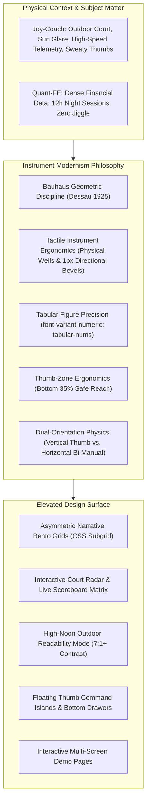
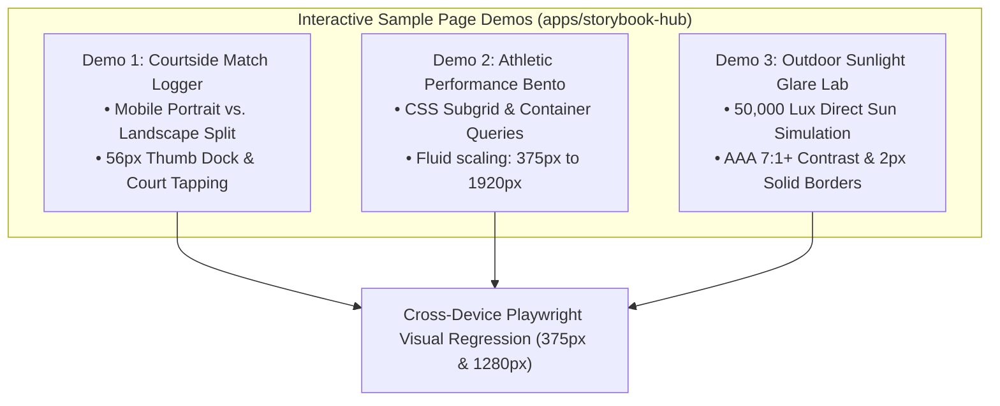
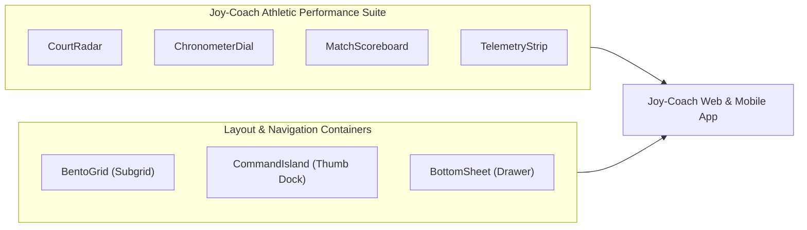
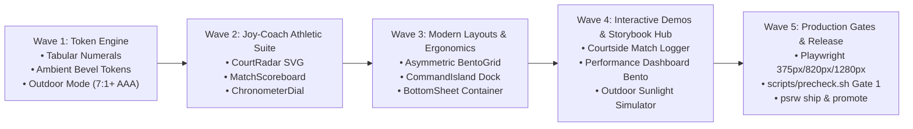

# Instrument Modernism: 2026 Web & Mobile Design Elevation & Joy-Coach Architecture

<div class="callout idea">
<strong>Design Thesis:</strong> Elevating <code>joy-design</code> from a conventional component suite to an <strong>Instrument-Grade Design System</strong>. Marrying 1925 Dessau Bauhaus geometric discipline with tactile athletic telemetry (<code>joy-coach</code>), mobile-first one-handed ergonomics, dual-orientation responsive physics, and financial-grade precision (<code>quant-fe</code>).
</div>

<div class="metric-grid">
  <div class="metric-tile">
    <div class="metric-label">Aesthetic Register</div>
    <div class="metric-value">Instrument</div>
    <div class="metric-delta">Composed · Exact · Tactile</div>
  </div>
  <div class="metric-tile">
    <div class="metric-label">Subject Matter</div>
    <div class="metric-value">Athletic + Fin</div>
    <div class="metric-delta">Court Telemetry & Trading Desks</div>
  </div>
  <div class="metric-tile">
    <div class="metric-label">Ergonomic Standard</div>
    <div class="metric-value">Thumb Zone 75%</div>
    <div class="metric-delta">Bottom-third safe reach & 56px touch floor</div>
  </div>
  <div class="metric-tile">
    <div class="metric-label">Responsiveness</div>
    <div class="metric-value">Small · Med · Lg</div>
    <div class="metric-delta">Dual-orientation: Vertical & Horizontal</div>
  </div>
  <div class="metric-tile">
    <div class="metric-label">Outdoor Sunlight</div>
    <div class="metric-value">WCAG 2.2 AAA</div>
    <div class="metric-delta">≥7.0:1 contrast at 50,000 lux glare</div>
  </div>
  <div class="metric-tile alarm">
    <div class="metric-label">Anti-Pattern Defense</div>
    <div class="metric-value">Zero Slop</div>
    <div class="metric-delta">Banned cream monoculture & card-clones</div>
  </div>
</div>

---

## 1. Executive Summary & Aesthetic Grounding <span class="topic-chip">Creative Direction</span>

### The 2026 Industry Landscape: "The Year of Restraint"
In 2025 and 2026, web and mobile design systems reached a pivotal inflection point. After years of chasing experimental AI generation artifacts—characterized by warm cream/sand backgrounds (`#F4F1EA`), identical 3-card rounded grids with lazy 20px grey drop-shadows, decorative glassmorphism blurs, gradient text, tracked all-caps eyebrows, and numbered `01 / 02 / 03` scaffolding—the design industry has entered **The Year of Restraint**.

Modern, high-craft software—typified by tools like **Linear, Raycast, Vercel, and Figma**—has established a new paradigm: **Calm, High-Efficiency Infrastructure**. Interfaces are no longer decorative canvases; they are high-performance instruments designed to minimize cognitive friction, maximize information throughput, and respect human physical ergonomics.



### Dual Persona Demands
`joy-design` serves two exacting product universes:
1. **`quant-fe`**: Traders and analysts monitoring real-time market data across multi-monitor desks during 12-hour shifts. Requires extreme typographic density, zero horizontal layout jitter on tick updates, mechanical visual calm, and rapid keyboard-first navigation (`Cmd+K`).
2. **`joy-coach`**: Tennis coaches, performance directors, and athletes reviewing match video, rally kinematics, and shot placement on mobile devices outdoors under blinding sunlight. Requires one-handed thumb reachability, large 56px touch targets operable with athletic gloves or sweaty hands, and instant 3-second glanceability.

To fulfill these demands, `joy-design` rejects generic SaaS tropes and establishes **Instrument Modernism** — fusing the geometric rigor of Dessau Bauhaus (1925), the visual discipline of Otl Aicher's Munich 1972 Olympics, and the tactile materiality of Braun, Leica, and Teenage Engineering hardware.

---

## 2. Multi-Screen Responsiveness & Dual-Orientation Architecture <span class="topic-chip">Ergonomics & Layout</span>

A premier design system in 2026 cannot treat mobile and tablet as afterthought CSS flex wraps. A tennis coach operates their device in two radically distinct physical modes:
1. **Vertical (Portrait)**: Held single-handed while walking the baseline or demonstrating a grip. Controlled exclusively with the thumb.
2. **Horizontal (Landscape)**: Resting on a court bench, mounted to a tripod, or gripped with both hands to review wide-angle video replay alongside court trajectory telemetry.

### The Responsive Usability Matrix

| Device Tier | Viewport Range | Primary Orientation | Interaction Physics | Layout Strategy |
| :--- | :--- | :--- | :--- | :--- |
| **Small (Mobile)** | `375px – 430px` | **Vertical (Portrait)** | Single-handed thumb sweep (bottom 35% safe reach). | Single-column vertical stack, bottom sheet drawers, vertical CourtRadar (`1:1.6` aspect ratio), 56px touch floor. |
| **Small (Mobile)** | `667px – 932px` | **Horizontal (Landscape)** | Two-thumb edge grip; center reserved for visual tracking. | Split-screen (`55% Court/Video` left, `45% Telemetry/Logger` right), edge-docked thumb controls, camera notch clearance. |
| **Medium (Tablet)** | `768px – 834px` | **Vertical (Portrait)** | Clipboard hold with index/thumb tapping. | 2-tier stacked split (Top 45% live scoreboard & metrics, Bottom 55% court drill planner). |
| **Medium (Tablet)** | `1024px – 1194px` | **Horizontal (Landscape)** | Two-handed bench or desk operation. | 3-column asymmetric bento (`25% Scoreboard` \| `50% CourtRadar` \| `25% Biometrics`). |
| **Large (Desktop)** | `1280px – 1920px+` | **Horizontal (Landscape)** | Keyboard-first (`Cmd+K`) + high-precision mouse tracking. | Full CSS Subgrid multi-pane analytics cockpit, high information density, zero layout shift. |

---

### Detailed Device Physics & Schematics

#### 1. Small Screen — Vertical (Mobile Portrait, 375px–430px)
*   **Touch Envelope**: All primary actions (Point Won/Lost, Shot Type, Lap Split) must reside within the **Safe Thumb Zone** (bottom 35% of screen height).
*   **Viewport Unit Enforcement**: Uses `height: 100dvh` (Dynamic Viewport Height) to eliminate unwanted layout jumping caused by mobile browser address bars.
*   **Safe Area Padding**: Enforces `padding-bottom: max(16px, env(safe-area-inset-bottom))` above the system home indicator.

```
┌──────────────────────────────────────────────┐
│ TOP THIRD: STATIC TELEMETRY (Passive Glance) │
│ • Match Timer Clock: 01:42:18.9 (Tabular)    │  ◄── Zero interaction required;
│ • Tournament / Player Header (12px clean)    │      viewed at a glance.
├──────────────────────────────────────────────┤
│ MIDDLE THIRD: STRETCH ZONE (Visual Context)  │
│ • Compact CourtRadar (Singles court)         │  ◄── Live shot trajectory display;
│ • Mini Momentum Sparkline                    │      pinch-to-zoom supported.
├──────────────────────────────────────────────┤
│ BOTTOM THIRD: SAFE THUMB ZONE (75% Activity) │
│ • 56px Touch Buttons: [WINNER] [ERR] [ACE]   │  ◄── Primary coach logging controls;
│ • Bottom Sheet Peek: Swipe up for deep stats │      effortless one-handed reach.
│ • Floating Command Island                    │
└──────────────────────────────────────────────┘
```

#### 2. Small Screen — Horizontal (Mobile Landscape, 667px–932px)
*   **Bi-Manual Edge Ergonomics**: The user grips the phone with both hands. The center of the screen is physically difficult to touch, but the left and right 25% margins are immediately under both thumbs.
*   **Split-Pane Visualization**:
    *   **Left Pane (55% width)**: Wide-angle CourtRadar or synchronized match replay video.
    *   **Right Pane (45% width)**: Vertical scoreboard matrix and thumb-placed shot marker keys.
*   **Camera Notch & Dynamic Island Protection**: Enforces `padding-left: env(safe-area-inset-left)` and `padding-right: env(safe-area-inset-right)`.

```
┌──────────────────────────────────────┬───────────────────────────────────────┐
│ LEFT THUMB & VISUAL ZONE (55% width) │ RIGHT THUMB ACTION DOCK (45% width)   │
│                                      │                                       │
│  CourtRadar (Horizontal Mode)          │  SET 3 · GAME 11 · DEUCE [40 - 40]    │
│  - Full baseline-to-baseline view    │  ┌─────────────────┬────────────────┐ │
│  - Ball impact heatmap overlay       │  │ [1st SERVE IN]  │ [FAULT]        │ │
│  - Net clearance height arc          │  ├─────────────────┼────────────────┤ │
│                                      │  │ [FOREHAND WIN]  │ [UNFORCED ERR] │ │
│                                      │  └─────────────────┴────────────────┘ │
│  ◄── Left thumb: view controls       │   Right thumb: rapid point logging ──►│
└──────────────────────────────────────┴───────────────────────────────────────┘
```

#### 3. Medium Screen — Vertical (Tablet Portrait, 768px–834px)
*   **Coach Clipboard Mode**: Tablets held in portrait mimic traditional coaching clipboards.
*   **Balanced Vertical Split**:
    *   **Upper Deck (40% height)**: Live telemetry strip, player heart rate zone indicators, and set-by-set mechanical score matrix.
    *   **Lower Deck (60% height)**: Full-size interactive `CourtRadar` with draggable tactical marker pins, trajectory angles, and tactical drill pathing.

#### 4. Medium & Large Screens — Horizontal (Tablet Landscape & Desktop, 1024px–1920px+)
*   **Asymmetric Narrative Bento Grid**: Leverages CSS Subgrid for rhythmic track alignment.
*   **Cockpit Architecture**:
    *   Column 1 (25% width): `MatchScoreboard` + live chronometer dial.
    *   Column 2 (50% width): Interactive `CourtRadar` hero instrument with tactical filters (Forehand, Backhand, Serve, Slice).
    *   Column 3 (25% width): `TelemetryStrip` biometrics, kinematic speed gauges, and rally length histogram.
    *   Row 2 (100% width): Split-interval milestone ribbon.

---

## 3. Sports Telemetry & The Three-Second Glanceability Rule <span class="topic-chip">Athletic Precision</span>

### The "Three-Second Rule" on the Tennis Court
A tennis coach standing courtside cannot parse a 20-row data table or an intricate line graph during a 20-second changeover. Telemetry interfaces must pass the **Three-Second Glanceability Test**: a coach must understand the current tactical state within 3 seconds, with the option to drill down via progressive disclosure.

### Telemetry Architecture: Comparative Benchmark

| Platform | Core Design Strategy | Joy-Design Adoption for Joy-Coach |
| :--- | :--- | :--- |
| **Whoop** | **3-Tier Progressive Disclosure**: High-level daily score → trend patterns → raw biometric graphs. | `ScoreRing` and `TelemetryStrip` provide top-level status with expandable bottom-sheet deep dives. |
| **SwingVision** | **Automated AI Capture & High-Contrast Overlay**: Video tracking converted into simple visual line calls and shot placement clusters. | `CourtRadar` component plots impact clusters and trajectory vectors with high-contrast court surface skins. |
| **Strava** | **Centralized Telemetry Dashboard**: Modular activity cards with prominent pace/heart-rate splits and community milestones. | `MatchScoreboard` and `BentoGrid` split match progress into clear, distinct physical cards. |
| **Apple Fitness+** | **Ring Completion & Real-Time Burn Bar**: Dynamic radial visualization providing instant visual feedback on progress. | `ChronometerDial` circular SVG countdown and serve clock with color-coded exertion bands. |

### Zero-Jiggle Numerals Engine (`font-variant-numeric: tabular-nums`)
In real-time athletic timing and financial tick streams, numbers are continuously incrementing. Amateur interfaces experience horizontal "jitter" or layout shake because glyphs like `1` and `0` have varying proportional widths in standard fonts.

`joy-design` mandates strict tabular lining numerals:
```css
/* Zero-Jiggle Numeric Specification */
.joy-tabular-nums {
  font-variant-numeric: tabular-nums lining-nums;
  font-feature-settings: "tnum" 1, "lnum" 1;
  letter-spacing: -0.01em;
}
```

Every timer, scoreboard, shot speed readout, and financial order book entry renders with fixed-width glyph channels, ensuring complete rock-solid visual calm.

---

## 4. Modern Web Layouts & CSS Subgrid Bento Architecture <span class="topic-chip">Layout Engineering</span>

### Moving Beyond the 3-Card SaaS Monoculture
The universal SaaS homepage format—three identical rounded cards side-by-side with an icon, title, and body—is an ergonomic and aesthetic dead end. Modern web layouts employ **Asymmetric Narrative Bento Grids** that establish clear hierarchy and guide the user's attention.

```
┌───────────────────────────────────────────────────────────────┬──────────────────────────────┐
│ HERO ANCHOR (65% width / 2 rows)                              │ TOP METRIC (35% width)       │
│ CourtRadar: Live Shot Placement & Trajectory Vectors          │ 1st Serve Speed: 204 km/h    │
│ • Surface Mode: Roland Garros Clay / Wimbledon Grass          │ ▲ +8 km/h vs Match Average   │
│ • Interactive Ball Impact Clusters                            ├──────────────────────────────┤
│ • Net Clearance Arc Visualization                             │ UNFORCED ERROR RATIO         │
│                                                               │ 12 Forehand · 4 Backhand     │
├───────────────────────────────────────────────────────────────┴──────────────────────────────┤
│ CHRONOMETER & MATCH SPLIT RIBBON (100% width)                                                │
│ Set 1: 6-4 · Set 2: 3-6 · Set 3: 5-4 [Break Point 30-40] · Match Time: 01:52:14.2           │
└──────────────────────────────────────────────────────────────────────────────────────────────┘
```

### CSS Subgrid Alignment Engine
Traditional CSS Grid layouts suffer when child cards have varying text lengths, resulting in unevenly aligned headers, metric figures, and action buttons. `joy-design` leverages **CSS Subgrid** so child elements inherit parent track lines across asymmetric cards without JavaScript calculations.

```css
/* Asymmetric Bento Container with Native Subgrid */
.joy-bento-grid {
  display: grid;
  grid-template-columns: repeat(12, 1fr);
  grid-auto-rows: auto 1fr auto; /* Row 1: Header, Row 2: Metric, Row 3: Footer */
  gap: var(--joy-space-4);
}

.joy-bento-card--hero {
  grid-column: span 8;
  grid-row: span 2;
  display: grid;
  grid-template-rows: subgrid;
}

.joy-bento-card--stat {
  grid-column: span 4;
  grid-row: span 1;
  display: grid;
  grid-template-rows: subgrid;
}
```

### Container Queries (`@container`)
Rather than relying on viewport-wide media queries (`@media (min-width: 768px)`), modern design system components adapt directly to their immediate parent container width:
```css
/* Component self-awareness */
.joy-court-radar-container {
  container-type: inline-size;
  container-name: court-radar;
}

@container court-radar (max-width: 480px) {
  .joy-court-radar__sidebar {
    display: none; /* Collapse secondary stats into bottom drawer */
  }
  .joy-court-radar__court {
    aspect-ratio: 1 / 1.6; /* Switch to vertical court orientation for mobile */
  }
}
```

---

## 5. Materiality, Micro-Depth & Directional Light <span class="topic-chip">Visual Craft</span>

### The "Linear / Raycast" Micro-Depth Revolution
Modern premium software does not rely on blurry, heavy drop-shadows or translucent frosted glass. Instead, it utilizes **1px Directional Ambient Bevels** and **Tactile Sunken Wells** to evoke the feel of precision CNC-milled hardware.

<div class="row two">
<div>

#### 1. Directional Ambient Bevel
Simulates crisp overhead architectural illumination:
- **Dark Mode**: 
  `box-shadow: inset 0 1px 0 0 rgba(255, 255, 255, 0.08);`
- **Light Mode**: 
  `box-shadow: inset 0 1px 0 0 rgba(255, 255, 255, 0.70);`
- Gives cards, buttons, and badges a crisp, physical metallic or ceramic edge.

</div>
<div>

#### 2. Tactile Sunken Wells (`--joy-surface-sunken`)
- Search fields, court coordinate tracks, scoreboard cells, and code blocks sit in a physical "well":
- `background: var(--joy-surface-sunken);`
- `box-shadow: inset 0 1px 2px rgba(0, 0, 0, 0.12);`
- Establishes clear visual grouping without adding distracting border lines.

</div>
</div>

### Tactile Physical Feedback Matrix
Every interactive element adheres to a strict physical response cycle:
*   **Default**: 1px subtle border (`--joy-border-default`) + top 1px inner ambient highlight.
*   **Hover**: Ambient lift (`transform: translateY(-1px)`) + subtle border contrast elevation.
*   **Active / Pressed**: Mechanical spring compression (`transform: translateY(1px) scale(0.99)`) + inner shadow depression.
*   **Focus-Visible**: High-contrast 2px offset focus ring (`--joy-focus-ring`) with 2px offset.
*   **Disabled**: Opacity 0.45, cursor `not-allowed`, zero transform feedback.

---

## 6. High-Noon Outdoor Mode (`--joy-mode-outdoor`) <span class="topic-chip">Accessibility & Glare</span>

### The 50,000 Lux Sunlight Problem
In direct outdoor sunlight (50,000 to 100,000 lux on an open court), subtle 1px border contrast (`#e3dccc`) and muted secondary text (`#686660`) disappear completely. The screen washes out, making match recording impossible.

<div class="callout warn">
<strong>Sunlight Failure Mode:</strong> Standard light and dark modes designed for indoor office environments fail outdoors. Subtle 10% translucent badge tints become invisible, and low-contrast borders collapse into a solid haze.
</div>

### Token Architecture: `--joy-mode-outdoor`
When activated via `[data-mode="outdoor"]` or through a dedicated quick-toggle, the system shifts into **High-Noon High-Contrast Mode**:

| Token Role | Standard Mode (Indoor) | High-Noon Outdoor Mode | Benefit Under Glare |
| :--- | :--- | :--- | :--- |
| **Minimum Contrast** | 4.5:1 (WCAG AA) | **≥ 7.0:1 (WCAG AAA)** | Crisp legibility under direct sun |
| **Component Borders** | 1px subtle (30% opacity) | **2px solid high-opacity** (`#090D14` / `#FFFFFF`) | High edge definition against sun washout |
| **Status Badges** | 10% translucent tint fill | **Solid 100% fill with inverted text** | Immediate recognition without color bleeding |
| **Court Radar Lines** | 1px chalk line | **3px bold chalk boundary** | Clear in/out bounce verification |
| **Active States** | Accent tint background | **Stark inverse ink fill with white text** | Zero ambiguity on selected controls |

---

## 7. Interactive Sample Page Demos Specification <span class="topic-chip">Interactive Prototypes</span>

To demonstrate cross-device usability, responsiveness, and aesthetic elevation across all viewport tiers and orientations, three flagship interactive demo pages are specified for `apps/storybook-hub`:



### Demo 1: Courtside Live Match Logger (`/demos/courtside-logger`)
*   **Target Objective**: Prove effortless match scoring and shot placement recording under mobile one-handed and two-thumb landscape conditions.
*   **Interactive Behaviors**:
    1.  **Court Tap-to-Mark**: Tapping any location on the `CourtRadar` places a tennis ball impact pin with automatic coordinate detection (`[X: 4.2m, Y: 11.8m]`, "Inside Baseline, Forehand Corner").
    2.  **Thumb Action Stepper**: Bottom 56px action keys increment the point score: `[ACE]`, `[WINNER]`, `[UNFORCED ERROR]`, `[DOUBLE FAULT]`.
    3.  **Live Scoreboard Tick**: Games increment with zero-jitter tabular slide animation: `15 - 0` → `30 - 0` → `40 - 0` → `GAME`.
    4.  **Orientation Flip**: Automatically reorganizes layout when the viewport changes from Portrait (stacked vertical drawer) to Landscape (55/45 split).

### Demo 2: Coach Performance & Kinematics Bento (`/demos/coach-dashboard`)
*   **Target Objective**: Showcase modern narrative bento layout, CSS Subgrid alignment, and responsive container queries across Small, Medium, and Large viewports.
*   **Interactive Behaviors**:
    1.  **Hero Anchor Tile**: Live `CourtRadar` showcasing shot trajectory arcs with net clearance height bars.
    2.  **Surface Preset Switcher**: Toggle court skin between Roland Garros Clay, Wimbledon Grass, and US Open Hard Court in real time.
    3.  **Biometric Cardio Ribbon**: Real-time heart rate zone progression (Zone 1 to Zone 5) with smooth SVG pulse pips.
    4.  **Container Query Inspection**: Resizing the browser window demonstrates seamless component adaptation without horizontal scrolling or clipping.

### Demo 3: Outdoor Sunlight & Glare Simulator (`/demos/outdoor-glare`)
*   **Target Objective**: Verify aesthetic readiness and extreme accessibility under harsh lighting environments.
*   **Interactive Behaviors**:
    1.  **Simulated Ambient Lux Slider**: Slide from `500 lux` (indoor office) to `50,000 lux` (bright midday sun) to `100,000 lux` (harsh summer glare).
    2.  **Outdoor Mode Quick-Toggle**: Activates `[data-mode="outdoor"]` with 1-click tactile feedback.
    3.  **Live Contrast Auditor**: Renders real-time WCAG 2.2 contrast badges (AA vs. AAA) for every rendered label, card edge, and badge.

---

## 8. Joy-Coach Specialized Component Specifications <span class="topic-chip">Component Suite</span>

To cement `joy-design` as the premier design system for `joy-coach`, four flagship athletic components and two ergonomic containers are specified:



### 1. `CourtRadar` (Interactive SVG Tennis Court)
*   **Props**:
    *   `surface: 'clay' | 'grass' | 'hard' | 'indoor'`
    *   `mode: 'singles' | 'doubles'`
    *   `orientation: 'vertical' | 'horizontal' | 'auto'`
    *   `shots: Array<{ x: number, y: number, speed: number, type: 'serve'|'forehand'|'backhand'|'volley', result: 'in'|'out'|'net' }>`
    *   `interactive: boolean` (allows coach to tap court coordinates to place a ball mark)
*   **Visual Polish**:
    *   Roland Garros Clay: Terracotta `#C34A2C` with white chalk lines and zinc court boundary.
    *   Wimbledon Grass: Deep lush lawn `#1E4620` with royal purple court surround.
    *   US Open Hard Court: Bold cobalt blue `#1A4B8C` with sage green run-off zones.
    *   Smooth SVG trajectory arcs with net clearance height elevation indicators.

### 2. `MatchScoreboard` (Grand Slam Inspired Score Matrix)
*   **Props**:
    *   `players: [ { name: string, seed?: number, sets: number[], currentGame: string, serving: boolean, tiebreak?: number } ]`
    *   `format: 'best-of-3' | 'best-of-5'`
    *   `status: 'live' | 'completed' | 'interrupted'`
    *   `surface: string`
*   **Features**:
    *   Strict `font-variant-numeric: tabular-nums` score channels.
    *   Mechanical flip or subtle vertical slide transition on point increment.
    *   Point-by-point momentum sparkline integrated into the card footer.

### 3. `ChronometerDial` (Digital-Mechanical Precision Stopwatch)
*   **Props**:
    *   `elapsedMs: number`
    *   `state: 'idle' | 'running' | 'paused'`
    *   `laps: Array<{ lapNumber: number, splitMs: number, deltaMs: number }>`
    *   `mode: 'stopwatch' | 'serve-clock' | 'interval-drill'`
    *   `targetDurationMs?: number`
*   **Ergonomics**:
    *   Large 56px minimum touch target action buttons (Start/Pause, Split/Reset) in the bottom thumb zone.
    *   Circular SVG dial with animated radial sweep indicator.
    *   Haptic pulse trigger upon drill interval expiration.

### 4. `TelemetryStrip` (Athlete Biometrics & Kinematics)
*   **Props**:
    *   `heartRate: { current: number, zone: 1|2|3|4|5, max: number }`
    *   `serveVelocity: { top: number, average: number, unit: 'km/h'|'mph' }`
    *   `rallyCount: { current: number, longest: number }`
*   **Zero-Emoji Policy**:
    *   Exclusively utilizes crisp SVG vector glyphs (`@joymify/icons`), strictly barring raw OS emojis (`[Heart]`, `[Court]`, `[Zap]`).

### 5. `BentoGrid` & `BentoCard` (CSS Subgrid Architecture)
*   **Props**:
    *   `columns: 4 | 6 | 12`
    *   `asymmetric: boolean`
    *   `gap: 'sm' | 'md' | 'lg'`
*   **Features**:
    *   Integrated CSS Subgrid supporting automatic vertical alignment of headers, data bodies, and footers.
    *   Responsive container query breakpoints (`@container`).

### 6. `CommandIsland` (Mobile Floating Thumb Dock & Desktop Quick Bar)
*   **Props**:
    *   `items: Array<{ id: string, icon: IconComponent, label: string, shortcut?: string, badge?: string, active?: boolean }>`
    *   `placement: 'bottom-floating' | 'bottom-fixed' | 'top-header'`
    *   `onSelect: (id: string) => void`
*   **Features**:
    *   Mobile: Floating pill dock suspended 16px above safe-area inset.
    *   Desktop: Linear/Raycast style `Cmd+K` keyboard quick bar with `<kbd>` shortcut badges.

### 7. `BottomSheet` (Native Mobile Drawer Container)
*   **Props**:
    *   `open: boolean`
    *   `snapPoints: number[]` (e.g. `[0.15, 0.50, 0.90]`)
    *   `title: string`
    *   `onDismiss: () => void`
*   **Features**:
    *   Smooth touch drag gesture with velocity-based dismiss physics.
    *   Hardware accelerated CSS transforms (`translate3d`).

---

## 9. Anti-Pattern Defense & Comparative Blueprint

```
┌─────────────────────────────────────────────┬─────────────────────────────────────────────┐
│ TRADITIONAL AI-SLOP SAAS                    │ MODERN INSTRUMENT ELEVATION                 │
├─────────────────────────────────────────────┼─────────────────────────────────────────────┤
│ • Warm cream/sand beige background (#F4F1EA) │ • Authentic material surfaces (Canvas/Deck) │
│ • 3 identical rounded cards in a row        │ • Asymmetric narrative bento with subgrid   │
│ • Fuzzy 20px grey drop-shadows              │ • 1px directional ambient highlight + bevel │
│ • Gradient text ("Supercharge Your Game")   │ • Solid architectural display & sentence-case│
│ • Tracked all-caps eyebrows ("FEATURES")    │ • Functional hierarchy with micro-labels    │
│ • Numbers jiggle horizontally on data tick  │ • Strict tabular-nums & zero-jitter channels│
│ • Raw OS emojis (Court, Red, Hourglass, Moon) │ • Crisp scalable vector SVG icons           │
│ • Washes out under direct outdoor sunlight  │ • High-Noon Outdoor 7:1+ Mode (AAA contrast)│
│ • Centered modal dialogs unclickable with 1 │ • Bottom Sheets & Floating Thumb Dock       │
│   hand on modern mobile screens             │   (Safe Zone ergonomics)                    │
│ • Ignores horizontal mobile rotation        │ • Bi-manual landscape split-screen layout   │
└─────────────────────────────────────────────┴─────────────────────────────────────────────┘
```

---

## 10. Multi-Wave Implementation Roadmap



### Wave Breakdown
1. **Wave 1 — Token & Material Engine (`packages/tokens`)**:
   - Introduce directional ambient bevel tokens: `--joy-elevation-bevel-light`, `--joy-elevation-bevel-dark`.
   - Introduce High-Noon Outdoor mode tokens: `[data-mode="outdoor"]` with ≥7.0:1 AAA contrast pairs.
   - Define tabular numeral font scale tokens and utilities.
2. **Wave 2 — Joy-Coach Athletic Performance Suite (`packages/svelte` & `packages/react`)**:
   - Implement `CourtRadar` (Clay, Grass, Hard court SVG with ball placement heatmap).
   - Implement `MatchScoreboard` (live Grand Slam score matrix with tabular numeral slide).
   - Implement `ChronometerDial` (tactile stopwatch with split lap memory).
   - Maintain 100% Svelte 5 / React 19 parity verified via `scripts/parity-check.mjs`.
3. **Wave 3 — Modern Layout & Ergonomic Containers (`packages/svelte`, `packages/react`)**:
   - Implement `BentoGrid` and `BentoCard` leveraging CSS Subgrid and Container Queries.
   - Implement `CommandIsland` (floating mobile thumb dock + desktop `Cmd+K` bar).
   - Implement `BottomSheet` for one-handed mobile detail inspection.
4. **Wave 4 — Interactive Sample Page Demos (`apps/storybook-hub`)**:
   - Create Demo 1: Courtside Live Match Logger (`/demos/courtside-logger`).
   - Create Demo 2: Athletic Performance & Kinematics Bento (`/demos/coach-dashboard`).
   - Create Demo 3: Outdoor Sunlight Glare Simulator (`/demos/outdoor-glare`).
   - Add high-noon outdoor mode toggle alongside the 5 palette presets.
5. **Wave 5 — Production Verification & Release Automation**:
   - Playwright visual regression tests across mobile portrait (375px), mobile landscape (844px), tablet (820px), and desktop (1280px).
   - Gate 1 (`scripts/precheck.sh`) parity and color lint verification.
   - `psrw ship` and promotion pipeline.
