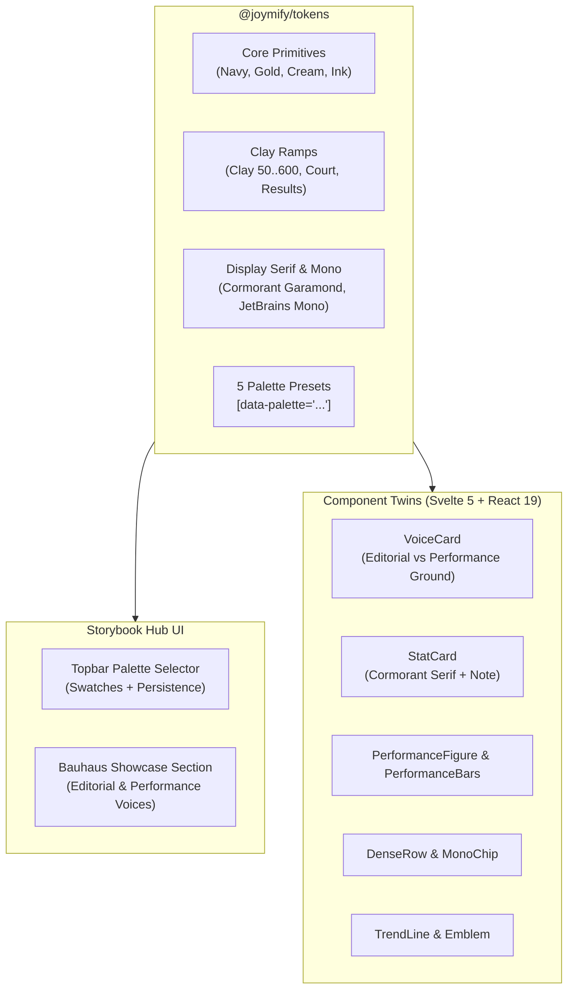

# Architecture Specification: Bauhaus Joy-Coach Integration & 5 Color Palette Presets

DESIGN SYSTEM ARCHITECTURE · F-049

## Executive Summary

This specification integrates the **Bauhaus design language** from `joy-coach` directly into the core **Joymify Design System** (`@joymify/tokens`, `@joymify/svelte`, `@joymify/react`, `@joymify/brand`), and introduces a **Dynamic 5-Preset Palette System** with an interactive switcher in the Storybook Hub.

---

## 1. Problem & Strategic Motivation

### 1.1 Vendored Token Debt in `joy-coach`
In `joy-coach` (`/Users/pasitnusso/workspace/repos/joy-coach/joy-coach-svc/packages/ui`), the app was forced to vendor a reconstruction of `joymify-base.css` and layer `joy-coach-tokens.css` because Joymify lacked:
- The **Clay ramp** (`--clay-50`..`--clay-600`) and court surface tokens (`--surface-clay-*`, `--surface-grass-*`, etc.).
- **Result & Sports analytics semantics** (`--result-won`, `--result-lost`, `--result-retired`, `--result-title`).
- **Display Serif typography** (`--font-display: 'Cormorant Garamond'`) and tabular lining numeral standards.
- Bauhaus structural primitives (`VoiceCard`, `PerformanceBars`, `DenseRow`, `MonoChip`, `Emblem`).

### 1.2 Lack of Multi-Palette Exploration in Storybook
Joymify's Storybook Hub currently offers only a binary Dark/Light toggle on a single Navy/Gold palette. Teams designing across different product brands (enterprise finance, tennis analytics, modern minimal, editorial sports) need to explore how components render under different curated color harmonies without overriding CSS.

---

## 2. The 5 Curated Palette Presets

Each preset supports both **Light** and **Dark** modes via semantic tokens, maintaining full WCAG AA/AAA contrast compliance (≥4.5:1 text, ≥3:1 UI components).

### 1. Joy Classic (Signature Navy & Gold)
*The foundational Joymify & Joy-Coach anchor.*
- **Brand Navy**: `#14253e` (dark: `#14253e`)
- **Accent Gold**: `#c49a3a` (dark: `#dab362`)
- **Canvas Cream**: `#f8f3e8` (dark: `#0d1624`)
- **Card Paper**: `#ffffff` (dark: `#111b2b`)
- **Text Ink**: `#1f1c13` (dark: `#f8f3e8`)

### 2. Bauhaus Primary (Dessau Geometric Triad)
*Authentic modernist Bauhaus primary harmony (Kandinsky / Walter Gropius).*
- **Primary Cobalt**: `#1a365d` (dark: `#2563eb`)
- **Crimson Red**: `#b91c1c` (dark: `#ef4444`)
- **Cadmium Ochre**: `#d97706` (dark: `#f59e0b`)
- **Canvas Chalk**: `#f9fafb` (dark: `#0b0f17`)
- **Card Paper**: `#ffffff` (dark: `#111827`)
- **Text Onyx**: `#111827` (dark: `#f9fafb`)

### 3. Clay Court (Roland-Garros & Joy-Coach)
*Direct tennis clay court & alpine olive heritage.*
- **Terracotta Clay**: `#a85a34` (dark: `#c97c52`)
- **Deep Umber**: `#63311b` (dark: `#dfb093`)
- **Court Forest**: `#2d5a27` (dark: `#6b7f4a`)
- **Canvas Bisque**: `#fbf0ea` (dark: `#18110d`)
- **Card Paper**: `#ffffff` (dark: `#231813`)
- **Text Espresso**: `#261c14` (dark: `#fbf0ea`)

### 4. Bauhaus Steel / Nordic Slate (Minimalist)
*Architectural modernist steel & cool precision.*
- **Graphite Slate**: `#334155` (dark: `#64748b`)
- **Ice Cerulean**: `#0284c7` (dark: `#38bdf8`)
- **Pure Steel**: `#64748b` (dark: `#94a3b8`)
- **Canvas Cold Paper**: `#f8fafc` (dark: `#0b1120`)
- **Card Paper**: `#ffffff` (dark: `#131d31`)
- **Text Obsidian**: `#0f172a` (dark: `#f8fafc`)

### 5. Verdant Lawn (Wimbledon & Racing Green)
*Lawn tennis green and champagne gold elegance.*
- **British Racing Green**: `#1b4332` (dark: `#2d6a4f`)
- **Champagne Gold**: `#c9a227` (dark: `#e0be4a`)
- **Lawn Olive**: `#40916c` (dark: `#74c69d`)
- **Canvas Ivory**: `#f4f6f0` (dark: `#091611`)
- **Card Paper**: `#ffffff` (dark: `#0f221b`)
- **Text Forest**: `#081c15` (dark: `#f4f6f0`)

---

## 3. Token Layer Enhancements (`@joymify/tokens`)

### 3.1 Clay & Court Scale Addition
Added to `packages/tokens/src/tokens.json`:
- `--joy-color-clay-50`: `#FBF0EA`
- `--joy-color-clay-100`: `#F0D8C9`
- `--joy-color-clay-200`: `#DFB093`
- `--joy-color-clay-300`: `#C97C52`
- `--joy-color-clay-400`: `#A85A34` (Base)
- `--joy-color-clay-500`: `#8A4526`
- `--joy-color-clay-600`: `#63311B`
- Semantic mappings:
  - `--joy-court`: `var(--joy-color-clay-400)`
  - `--joy-court-soft`: `var(--joy-color-clay-100)`
  - `--joy-court-line`: `var(--joy-color-navy-500)`
  - `--joy-surface-clay-bg`: `var(--joy-color-clay-100)`
  - `--joy-surface-clay-fg`: `var(--joy-color-clay-500)`
  - `--joy-surface-grass-bg`: `#E4EADA`
  - `--joy-surface-grass-fg`: `#4E5F36`
  - `--joy-surface-hard-bg`: `#E2E8EF`
  - `--joy-surface-hard-fg`: `var(--joy-color-navy-500)`
  - `--joy-surface-indoor-bg`: `var(--joy-color-cream-300)`
  - `--joy-surface-indoor-fg`: `var(--joy-text-secondary)`

### 3.2 Sports / Performance Results Semantics
- `--joy-result-won`: `var(--joy-status-success-fg)`
- `--joy-result-won-bg`: `var(--joy-status-success-bg)`
- `--joy-result-lost`: `var(--joy-status-danger-fg)`
- `--joy-result-lost-bg`: `var(--joy-status-danger-bg)`
- `--joy-result-retired`: `var(--joy-status-warning-fg)`
- `--joy-result-title`: `var(--joy-accent-default)`

### 3.3 Typography Expansion
- `--joy-font-display`: `'Cormorant Garamond', 'Noto Serif Thai', Garamond, serif`
- `--joy-stat-numeric`: `lining-nums tabular-nums`

---

## 4. Component Twins (`@joymify/svelte` & `@joymify/react`)

1. **`VoiceCard`**:
   - Supports two non-mixing voices: `'editorial'` and `'performance'`.
   - Supports grounds: `'paper'`, `'deep'`, `'sunken'`, `'flat'`.
   - Renders optional small-caps tracked eyebrow and caption note.
2. **`StatCard`**:
   - Retains backward compatibility for simple enterprise stat display.
   - Adds rich editorial mode: `eyebrow`, `figure` (rendered in `--joy-font-display` serif), `unit`, `qualifier`, `delta`, `deltaTone`, `progress` bar, and `note`.
3. **`PerformanceFigure`**:
   - Monospace tabular figure with unit and tally badge.
4. **`PerformanceBars`**:
   - Sequence of square outcome blocks (win/loss/neutral) without decorative rounding.
5. **`DenseRow`**:
   - Ultra-compact metrics row for match and trading feeds.
6. **`MonoChip`**:
   - Fixed-pitch chip for IDs, player tags, and court zones.
7. **`TrendLine`**:
   - High-density sparkline with 2-series constraint.
8. **`Emblem`**:
   - Bauhaus circular badge with SVG circular text, center disc, and ring accents.

---

## 5. Storybook Hub Palette Switcher

- Placed in topbar next to the Theme Toggle button.
- Custom dropdown pill displaying the active preset name and a 3-dot color swatch preview (`brand`, `accent`, `canvas`).
- Saves preference to `localStorage.getItem('joy-palette')` and sets `data-palette="..."` on `document.documentElement`.
- Includes a new **Bauhaus & Sports Analytics** view panel in the Storybook Hub demonstrating both voices and interactive court widgets.

---

## 6. Verification Criteria

1. **Gate 1 Precheck**: All 589+ Playwright tests and unit tests pass with zero regressions.
2. **Color Lint**: `scripts/lint-colors.sh` passes with 0 literal color violations.
3. **Parity Check**: `node scripts/parity-check.mjs` passes with 0 violations across Svelte and React twins.
4. **Contrast Verification**: Tokens contrast test verifies all 5 presets meet ≥4.5:1 text and ≥3:1 UI contrast in both Light and Dark modes.
5. **Interactive UI Verification**: Storybook Hub switching persists across refresh and re-renders all components cleanly.
