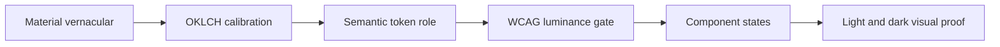

# Production-grade aesthetic palettes

**Status:** Design specification for implementation  
**Date:** 2026-10-03  
**System:** Joymify Design System (`joy-design`)  
**Decision owner:** Design systems architecture  

<div class="callout success">
<strong>Decision.</strong> Keep five presets, but rebuild them as restrained product palettes with one unambiguous action accent, culturally specific material neutrals, perceptually measured OKLCH relationships, and WCAG 2.2 AA contrast in every theme. Bauhaus red becomes a supporting emblem—not the default button. Nordic loses generic sky-blue. Clay dark mode uses fired terracotta—not powder peach.
</div>

## Executive direction

Joymify is a component system for dense finance tools, outdoor coaching products, investor-facing portals, and brand surfaces. `PRODUCT.md` defines its personality as **composed, exact, warm** and `DESIGN.md` requires semantic tokens, deliberately designed dark themes, restrained accent use, complete interaction states, and computed contrast. The palette system must therefore behave like a well-made instrument before it behaves like a mood board.

The five presets are not five unrelated skins. They share a stable semantic contract and differ through material character:

| Preset | Physical scene | Primary action | Supporting identity | Failure it eliminates |
|---|---|---|---|---|
| Joy Classic | Oxford ledger, navy cloth, brass instrument, parchment | Ochre Gold | Oxford Navy | Gold treated as decoration or wash |
| Dessau Bauhaus | Painted steel, glass, charcoal type, architectural wayfinding | Architectural Cobalt | Crimson and Cadmium emblems | Red primary buttons reading as delete/error |
| Clay Court | Sun-baked crushed brick, chalk line, shaded pine | Terracotta Clay | Court Pine | Powdery peach and cosmetic warmth |
| Nordic Slate | Granite, fjord water, silvered metal, cold paper | Fjord Navy | Granite Slate | Stock SaaS sky-blue on Tailwind gray |
| Verdant Lawn | Cut grass, racing green paint, ivory linen, trophy metal | British Racing Green | Champagne Gold | Generic emerald startup palette |

<div class="callout warn">
<strong>Names are vernacular references, not trademark color claims.</strong> The exact hex values below are Joymify design decisions inspired by the cited material cultures. They are not asserted to be official Bauhaus, Roland-Garros, Wimbledon, Oxford, or Nordic institutional brand values.
</div>

## Why the current presets feel non-production

### 1. Semantic collision: Bauhaus red means danger before it means history

The current `bauhaus-primary` makes `#b91c1c` / `#dc2626` the default action fill. In a state-rich product system, crimson already carries destructive, error, and loss semantics. Reusing it for ordinary submission forces users to re-interpret the same hue per component and makes every primary action feel irreversible.

The correction is not to erase red. The Bauhaus Dessau Foundation describes color as an architectural material used for orientation and spatial structure, with blue, red, and yellow differentiating areas. It also explicitly warns that primary colors are often mistakenly treated as the entirety of “typical Bauhaus” color. The production translation is therefore **cobalt for action**, charcoal for structure, and crimson/cadmium for bounded graphic emblems and badges—not red everywhere. [Bauhaus Building: colour as material](https://bauhaus-dessau.de/en/venues/bauhaus-building/), [Bauhaus Dessau on the primary-color cliché](https://bauhaus-dessau.de/en/adidas/).

### 2. Category default: Nordic is currently “Tailwind SaaS”

The current Nordic preset combines bright `#38bdf8` with familiar slate steps. It is competent but anonymous: the same sky-on-slate formula appears across developer tools and generated dashboards. Nordic material culture is better expressed by low-chroma granite structure, silver-mist paper, precise ice hairlines, and a darker fjord blue that behaves as ink rather than neon.

The palette uses natural and industrial material relationships rather than a reductive “Scandinavian equals pale blue” trope. Nordic design institutions emphasize material investigation and the interaction of light, form, and architecture; one documented exhibition combined black, light pine, and aluminum for a distinctly Nordic atmosphere. [Designmuseum Danmark: material investigation](https://designmuseum.dk/en/designmuseum-danmark-chart/), [Designmuseum Danmark annual report](https://designmuseum.dk/wp-content/uploads/2017/03/Designmuseum-Danmark-Aarsberetning2014.pdf).

### 3. Material mismatch: Clay dark mode becomes cosmetic peach

The current dark action accent is `#dfb093`, a low-authority powder peach. It reads as chalk, cosmetics, or a disabled tint, not as iron-rich crushed brick under stadium light. Roland-Garros describes the two-millimeter red-brick surface and its rich terracotta hue as a symbol of the tournament. The palette must retain particulate warmth and higher chroma in dark mode: `#d97746`, with a near-black fired-earth canvas. [Roland-Garros clay glossary](https://www.rolandgarros.com/en-us/article/roland-garros-jargon-explained).

### 4. Palette values are selected individually, not calibrated as a system

The generator already includes OKLCH conversion utilities, but preset values are mostly handwritten hex. That leaves uneven perceptual jumps, inherited roles with different undertones, and incomplete guarantees. The current preset contrast unit test checks accent text and primary text/canvas, but does not gate `text-secondary`, `text-muted`, `border-default`, card backgrounds, or every interactive accent state.

OKLCH is used here to control perceptual lightness, chroma, and hue; WCAG is still calculated from sRGB relative luminance. The two checks are complementary, not interchangeable. The W3C describes OKLCH as the polar form of Oklab with improved perceptual uniformity, while WCAG 2.2 requires 4.5:1 for normal text and 3:1 for meaningful UI boundaries. [CSS Color 4: Oklab and OKLCH](https://www.w3.org/TR/css-color-4/#ok-lab), [WCAG text contrast](https://www.w3.org/WAI/WCAG22/Understanding/contrast-minimum.html), [WCAG non-text contrast](https://www.w3.org/WAI/WCAG22/understanding/non-text-contrast.html).

## Palette principles and dosage

1. **One action color.** `accent-default`, `accent-hover`, and `accent-active` remain one hue family. Supporting identity colors never become default buttons.
2. **Restrained product dosage.** Neutral surfaces carry roughly 60% of visual weight, text/borders 30%, and action/status color at most 10%. Landing compositions may use a committed field, but components retain the same semantics.
3. **Material neutrals.** Each preset has a low-chroma neutral axis related to its anchor: warm ink for Classic, blue-charcoal for Bauhaus, fired earth for Clay, granite-blue for Nordic, and green-black for Verdant.
4. **Designed darkness.** Dark canvases sit near OKLCH L 0.16–0.20; cards rise by lightness. Accents are separately selected for dark use rather than inverted.
5. **No color-only meaning.** Crimson, yellow, green, and gold always pair with text, an icon, pattern, or geometry when they encode status or category.
6. **No gradient dependency.** The legacy `accent-gradient-end` key remains schema-compatible, but product components must not require a gradient. It is a related stop for approved brand surfaces only; gradient text remains prohibited.



## Curated preset directions

### Joy Classic — composed, exact, warm

- **Anchors:** Oxford Navy `#14253e`, Ochre Gold `#c49a3a` in light / `#dab362` in dark, Parchment Cream `#f8f3e8`.
- **Character:** institutional without austerity; warmth comes from gold and paper, not a beige wash across every component.
- **Usage:** gold is the primary action and focus signature; navy carries inverse surfaces and brand structure. Gold must remain rare enough to retain authority.
- **State correction:** the light hover and active golds are recalibrated to keep navy text above 4.5:1 in every action state.

### Dessau Bauhaus — architectural, functional, graphic

- **Anchors:** Architectural Cobalt `#1e40af` / `#2563eb`, Graphic Charcoal `#0f172a`, Crimson `#b91c1c` / `#dc2626`, Cadmium Yellow `#d97706` / `#f59e0b`.
- **Character:** painted steel and typographic geometry, not a primary-color toy kit.
- **Usage:** cobalt owns primary actions and focus. Charcoal owns typography and dark surfaces. Cadmium and crimson are restricted to emblems, geometric accents, chart series, and labeled badges.
- **Semantic firewall:** crimson cannot map to `accent-default`; destructive controls continue to use `status-danger-*`.

### Clay Court — sun-baked, athletic, tactile

- **Anchors:** Terracotta `#9c4221` action, material orange `#c85a32`, dark action `#d97746`, Court Line `#fbf0ea`, Court Pine `#264e22`.
- **Character:** crushed brick, chalk, sweat, shadow, and pine—not beauty-brand peach.
- **Usage:** pine is a secondary identity anchor and court/data reference; terracotta owns primary actions. Court-line white is a surface/text material, never a pure-white flood in dark mode.
- **Contrast note:** `#c85a32` is retained as a material anchor, not a white-text action fill; white on it is only 4.23:1. Light actions use the deeper `#9c4221` (6.53:1), and dark actions use dark ink on `#d97746` (5.94:1).

### Nordic Slate — quiet architecture, cold precision

- **Anchors:** Granite `#0f172a` / `#1e293b`, Fjord Navy `#0369a1`, Silver Mist `#f8fafc`.
- **Character:** mineral, low-chroma, precise. The blue behaves like deep water and architectural ink, not a luminous SaaS CTA.
- **Usage:** fjord navy owns action; granite owns structure; ice borders are visible at 3:1 without becoming decorative outlines.
- **Dark-mode choice:** retain a dark fjord action with white text rather than switching to bright sky blue.

### Verdant Lawn — sporting heritage, disciplined ceremony

- **Anchors:** British Racing Green `#143d2b` in light / `#22593d` in dark, Champagne Gold `#c9a227`, Lawn Ivory `#f4f6f0`.
- **Character:** cut grass, painted timber, linen, and trophy metal. Wimbledon’s historical compendium records green and purple as its established color scheme; Joymify borrows the lawn vernacular, not the complete official identity. [Wimbledon Compendium](https://www.wimbledon.com/pdf/TheWimbledon_Compendium_2019.pdf).
- **Usage:** green is the action and structural anchor; champagne is an emblem/highlight only. Do not turn gold into a competing CTA.
- **Calibration correction:** the first border candidate (`#829889`) failed against Lawn Ivory at 2.84:1. The accepted `#788f7f` reaches 3.20:1 on canvas and 3.48:1 on card.

## Exact OKLCH calibration

Coordinates were computed from the exact sRGB hex values with `packages/tokens/scripts/color.mjs::hexToOklch`. Format is `hex — oklch(L C H°)`; achromatic white uses `H none`. Values are rounded only for presentation to four decimals in L/C and one decimal in H. The source hex remains normative.

### Joy Classic

| Role | Light | Dark |
|---|---|---|
| surface-canvas | `#f8f3e8 — 0.9650 0.0155 86.4` | `#0d1624 — 0.1991 0.0314 259.0` |
| surface-card | `#ffffff — 1.0000 0.0000 none` | `#111b2b — 0.2212 0.0348 259.5` |
| text-primary | `#1f1c13 — 0.2268 0.0171 91.8` | `#f8f3e8 — 0.9650 0.0155 86.4` |
| text-secondary | `#3c3a35 — 0.3487 0.0089 88.7` | `#bab7b0 — 0.7799 0.0104 87.5` |
| text-muted | `#686660 — 0.5102 0.0096 91.6` | `#a2b2cb — 0.7594 0.0402 259.3` |
| border-default | `#88867f — 0.6197 0.0106 93.6` | `#566a87 — 0.5195 0.0521 257.6` |
| accent-default | `#c49a3a — 0.7079 0.1220 84.6` | `#dab362 — 0.7848 0.1096 84.1` |
| text-on-accent | `#14253e — 0.2636 0.0524 257.9` | `#0a121f — 0.1816 0.0296 259.8` |

### Dessau Bauhaus

| Role | Light | Dark |
|---|---|---|
| surface-canvas | `#f8fafc — 0.9842 0.0034 247.9` | `#090d16 — 0.1596 0.0203 265.6` |
| surface-card | `#ffffff — 1.0000 0.0000 none` | `#0f172a — 0.2077 0.0398 265.8` |
| text-primary | `#0f172a — 0.2077 0.0398 265.8` | `#f8fafc — 0.9842 0.0034 247.9` |
| text-secondary | `#334155 — 0.3717 0.0392 257.3` | `#cbd5e1 — 0.8690 0.0198 252.9` |
| text-muted | `#64748b — 0.5544 0.0407 257.4` | `#94a3b8 — 0.7107 0.0351 256.8` |
| border-default | `#7c8798 — 0.6202 0.0288 259.0` | `#64748b — 0.5544 0.0407 257.4` |
| accent-default | `#1e40af — 0.4244 0.1809 265.6` | `#2563eb — 0.5461 0.2152 262.9` |
| text-on-accent | `#ffffff — 1.0000 0.0000 none` | `#ffffff — 1.0000 0.0000 none` |

### Clay Court

| Role | Light | Dark |
|---|---|---|
| surface-canvas | `#fbf0ea — 0.9621 0.0144 50.8` | `#17110e — 0.1841 0.0117 48.1` |
| surface-card | `#fffaf7 — 0.9881 0.0067 53.4` | `#211713 — 0.2158 0.0180 42.8` |
| text-primary | `#261c14 — 0.2360 0.0215 60.1` | `#fbf0ea — 0.9621 0.0144 50.8` |
| text-secondary | `#4a3e35 — 0.3736 0.0225 58.9` | `#d8c3b7 — 0.8314 0.0290 51.8` |
| text-muted | `#73645b — 0.5148 0.0238 52.9` | `#b39a8c — 0.7046 0.0359 51.1` |
| border-default | `#9a7b6c — 0.6084 0.0447 47.2` | `#80604f — 0.5172 0.0493 49.2` |
| accent-default | `#9c4221 — 0.4937 0.1289 39.6` | `#d97746 — 0.6700 0.1379 45.9` |
| text-on-accent | `#ffffff — 1.0000 0.0000 none` | `#18110d — 0.1852 0.0142 51.3` |

### Nordic Slate

| Role | Light | Dark |
|---|---|---|
| surface-canvas | `#f8fafc — 0.9842 0.0034 247.9` | `#0b111b — 0.1768 0.0229 260.4` |
| surface-card | `#ffffff — 1.0000 0.0000 none` | `#111a27 — 0.2158 0.0290 257.5` |
| text-primary | `#0f172a — 0.2077 0.0398 265.8` | `#f8fafc — 0.9842 0.0034 247.9` |
| text-secondary | `#334155 — 0.3717 0.0392 257.3` | `#cbd5e1 — 0.8690 0.0198 252.9` |
| text-muted | `#64748b — 0.5544 0.0407 257.4` | `#94a3b8 — 0.7107 0.0351 256.8` |
| border-default | `#7b8796 — 0.6187 0.0267 254.0` | `#64748b — 0.5544 0.0407 257.4` |
| accent-default | `#0369a1 — 0.5000 0.1193 242.7` | `#075985 — 0.4434 0.1000 240.8` |
| text-on-accent | `#ffffff — 1.0000 0.0000 none` | `#ffffff — 1.0000 0.0000 none` |

### Verdant Lawn

| Role | Light | Dark |
|---|---|---|
| surface-canvas | `#f4f6f0 — 0.9700 0.0082 121.6` | `#09150f — 0.1820 0.0214 161.6` |
| surface-card | `#ffffff — 1.0000 0.0000 none` | `#0e2118 — 0.2281 0.0309 162.0` |
| text-primary | `#0b1e14 — 0.2151 0.0322 159.1` | `#f4f6f0 — 0.9700 0.0082 121.6` |
| text-secondary | `#29483a — 0.3727 0.0445 163.8` | `#c7d8cb — 0.8657 0.0255 152.8` |
| text-muted | `#526f5f — 0.5139 0.0423 160.3` | `#96ad9d — 0.7253 0.0343 155.1` |
| border-default | `#788f7f — 0.6272 0.0355 154.9` | `#5d7866 — 0.5459 0.0420 155.6` |
| accent-default | `#143d2b — 0.3252 0.0564 161.7` | `#22593d — 0.4187 0.0752 158.4` |
| text-on-accent | `#ffffff — 1.0000 0.0000 none` | `#ffffff — 1.0000 0.0000 none` |

## WCAG 2.2 contrast verification

Ratios were computed with the repository’s `contrastRatio()` implementation in `packages/tokens/scripts/color.mjs`. Text roles are gated at 4.5:1 against both canvas and card. `border-default` is treated as a meaningful UI boundary and gated at 3:1 against both surfaces. Ratios below are not rounded before pass/fail evaluation.

| Preset | Theme | On accent | Primary canvas/card | Secondary canvas/card | Muted canvas/card | Border canvas/card |
|---|---|---:|---:|---:|---:|---:|
| Joy Classic | Light | 5.89 | 15.38 / 17.02 | 10.26 / 11.36 | 5.19 / 5.74 | 3.29 / 3.64 |
| Joy Classic | Dark | 9.48 | 16.40 / 15.61 | 9.06 / 8.63 | 8.44 / 8.04 | 3.29 / 3.13 |
| Dessau Bauhaus | Light | 8.72 | 17.06 / 17.85 | 9.90 / 10.35 | 4.55 / 4.76 | 3.47 / 3.64 |
| Dessau Bauhaus | Dark | 5.17 | 18.57 / 17.06 | 13.09 / 12.02 | 7.58 / 6.96 | 4.08 / 3.75 |
| Clay Court | Light | 6.53 | 14.90 / 16.10 | 9.23 / 9.98 | 5.06 / 5.47 | 3.46 / 3.74 |
| Clay Court | Dark | 5.94 | 16.70 / 15.67 | 11.05 / 10.37 | 7.05 / 6.62 | 3.30 / 3.10 |
| Nordic Slate | Light | 5.93 | 17.06 / 17.85 | 9.90 / 10.35 | 4.55 / 4.76 | 3.49 / 3.65 |
| Nordic Slate | Dark | 7.56 | 18.08 / 16.71 | 12.74 / 11.78 | 7.38 / 6.82 | 3.97 / 3.67 |
| Verdant Lawn | Light | 12.12 | 15.94 / 17.35 | 9.26 / 10.08 | 5.08 / 5.53 | 3.20 / 3.48 |
| Verdant Lawn | Dark | 8.19 | 17.13 / 15.44 | 12.54 / 11.30 | 7.78 / 7.01 | 3.86 / 3.48 |

<div class="callout info">
<strong>Interaction-state gate.</strong> Implementation must also test `text-on-accent` against `accent-hover` and `accent-active`. The specified pairs all meet 4.5:1; this closes a gap in the current preset test, which checks only `accent-default`.
</div>

## Complete preset JSON

This object is a drop-in replacement for the `presets` dictionary shape in `packages/tokens/scripts/ramps.mjs`. Keys remain backward-compatible. Every theme explicitly supplies the contrast-critical text and border roles instead of relying on the global preset fallback.

```json
{
  "classic": {
    "name": "Joy Classic",
    "description": "Oxford Navy, Ochre Gold, Parchment Cream",
    "light": {
      "brand-navy": "#14253e",
      "brand-gold": "#c49a3a",
      "brand-cream": "#f8f3e8",
      "brand-ink": "#1f1c13",
      "accent-default": "#c49a3a",
      "accent-hover": "#d0aa52",
      "accent-active": "#b58b2f",
      "accent-subtle": "#fbf4e6",
      "accent-text": "#856515",
      "accent-gradient-end": "#b58b2f",
      "accent-highlight": "#e9cd94",
      "color-brand-primary": "#c49a3a",
      "surface-canvas": "#f8f3e8",
      "surface-card": "#ffffff",
      "surface-raised": "#ffffff",
      "surface-sunken": "#efe9dc",
      "text-primary": "#1f1c13",
      "text-secondary": "#3c3a35",
      "text-muted": "#686660",
      "text-on-accent": "#14253e",
      "border-subtle": "#e3dccc",
      "border-default": "#88867f",
      "border-strong": "#52504a",
      "border-focus": "#856515"
    },
    "dark": {
      "brand-navy": "#14253e",
      "brand-gold": "#dab362",
      "brand-cream": "#f8f3e8",
      "brand-ink": "#1f1c13",
      "accent-default": "#dab362",
      "accent-hover": "#e9cd94",
      "accent-active": "#c49a3a",
      "accent-subtle": "#1e2129",
      "accent-text": "#dab362",
      "accent-gradient-end": "#c49a3a",
      "accent-highlight": "#e9cd94",
      "color-brand-primary": "#dab362",
      "surface-canvas": "#0d1624",
      "surface-card": "#111b2b",
      "surface-raised": "#14253e",
      "surface-sunken": "#0a121f",
      "text-primary": "#f8f3e8",
      "text-secondary": "#bab7b0",
      "text-muted": "#a2b2cb",
      "text-on-accent": "#0a121f",
      "border-subtle": "#22324b",
      "border-default": "#566a87",
      "border-strong": "#7487a5",
      "border-focus": "#dab362"
    }
  },
  "bauhaus-primary": {
    "name": "Dessau Bauhaus",
    "description": "Architectural Cobalt, Graphic Charcoal, Crimson and Cadmium emblems",
    "light": {
      "brand-navy": "#1e40af",
      "brand-gold": "#d97706",
      "brand-cream": "#f8fafc",
      "brand-ink": "#0f172a",
      "accent-default": "#1e40af",
      "accent-hover": "#1d4ed8",
      "accent-active": "#1e3a8a",
      "accent-subtle": "#eff6ff",
      "accent-text": "#1e40af",
      "accent-gradient-end": "#2563eb",
      "accent-highlight": "#b91c1c",
      "color-brand-primary": "#1e40af",
      "surface-canvas": "#f8fafc",
      "surface-card": "#ffffff",
      "surface-raised": "#ffffff",
      "surface-sunken": "#f1f5f9",
      "text-primary": "#0f172a",
      "text-secondary": "#334155",
      "text-muted": "#64748b",
      "text-on-accent": "#ffffff",
      "border-subtle": "#dbe3ec",
      "border-default": "#7c8798",
      "border-strong": "#475569",
      "border-focus": "#1e40af"
    },
    "dark": {
      "brand-navy": "#2563eb",
      "brand-gold": "#f59e0b",
      "brand-cream": "#f8fafc",
      "brand-ink": "#0f172a",
      "accent-default": "#2563eb",
      "accent-hover": "#1d4ed8",
      "accent-active": "#1e40af",
      "accent-subtle": "#172554",
      "accent-text": "#93c5fd",
      "accent-gradient-end": "#1d4ed8",
      "accent-highlight": "#dc2626",
      "color-brand-primary": "#2563eb",
      "surface-canvas": "#090d16",
      "surface-card": "#0f172a",
      "surface-raised": "#1e293b",
      "surface-sunken": "#060910",
      "text-primary": "#f8fafc",
      "text-secondary": "#cbd5e1",
      "text-muted": "#94a3b8",
      "text-on-accent": "#ffffff",
      "border-subtle": "#334155",
      "border-default": "#64748b",
      "border-strong": "#94a3b8",
      "border-focus": "#60a5fa"
    }
  },
  "clay-court": {
    "name": "Clay Court",
    "description": "Roland-Garros Terracotta, Court Pine, Court Line White",
    "light": {
      "brand-navy": "#264e22",
      "brand-gold": "#c85a32",
      "brand-cream": "#fbf0ea",
      "brand-ink": "#261c14",
      "accent-default": "#9c4221",
      "accent-hover": "#87391d",
      "accent-active": "#6f2f19",
      "accent-subtle": "#f8e5da",
      "accent-text": "#87391d",
      "accent-gradient-end": "#c85a32",
      "accent-highlight": "#e7a17c",
      "color-brand-primary": "#9c4221",
      "surface-canvas": "#fbf0ea",
      "surface-card": "#fffaf7",
      "surface-raised": "#ffffff",
      "surface-sunken": "#f3ded2",
      "text-primary": "#261c14",
      "text-secondary": "#4a3e35",
      "text-muted": "#73645b",
      "text-on-accent": "#ffffff",
      "border-subtle": "#e5d1c6",
      "border-default": "#9a7b6c",
      "border-strong": "#765a4c",
      "border-focus": "#9c4221"
    },
    "dark": {
      "brand-navy": "#264e22",
      "brand-gold": "#d97746",
      "brand-cream": "#fbf0ea",
      "brand-ink": "#261c14",
      "accent-default": "#d97746",
      "accent-hover": "#e58b5d",
      "accent-active": "#cc6239",
      "accent-subtle": "#3a1d12",
      "accent-text": "#e99568",
      "accent-gradient-end": "#cc6239",
      "accent-highlight": "#f0b18f",
      "color-brand-primary": "#d97746",
      "surface-canvas": "#17110e",
      "surface-card": "#211713",
      "surface-raised": "#2d201a",
      "surface-sunken": "#0f0a08",
      "text-primary": "#fbf0ea",
      "text-secondary": "#d8c3b7",
      "text-muted": "#b39a8c",
      "text-on-accent": "#18110d",
      "border-subtle": "#463127",
      "border-default": "#80604f",
      "border-strong": "#a47c66",
      "border-focus": "#e58b5d"
    }
  },
  "nordic-slate": {
    "name": "Nordic Slate",
    "description": "Architectural Granite, Arctic Fjord Navy, Silver Mist Paper",
    "light": {
      "brand-navy": "#0f172a",
      "brand-gold": "#0369a1",
      "brand-cream": "#f8fafc",
      "brand-ink": "#0f172a",
      "accent-default": "#0369a1",
      "accent-hover": "#075985",
      "accent-active": "#0c4a6e",
      "accent-subtle": "#edf3f6",
      "accent-text": "#0369a1",
      "accent-gradient-end": "#075985",
      "accent-highlight": "#7d97a3",
      "color-brand-primary": "#0369a1",
      "surface-canvas": "#f8fafc",
      "surface-card": "#ffffff",
      "surface-raised": "#ffffff",
      "surface-sunken": "#eef2f5",
      "text-primary": "#0f172a",
      "text-secondary": "#334155",
      "text-muted": "#64748b",
      "text-on-accent": "#ffffff",
      "border-subtle": "#dce4e8",
      "border-default": "#7b8796",
      "border-strong": "#526071",
      "border-focus": "#0369a1"
    },
    "dark": {
      "brand-navy": "#1e293b",
      "brand-gold": "#0369a1",
      "brand-cream": "#f8fafc",
      "brand-ink": "#0f172a",
      "accent-default": "#075985",
      "accent-hover": "#0369a1",
      "accent-active": "#0c4a6e",
      "accent-subtle": "#102b3b",
      "accent-text": "#8bb9cf",
      "accent-gradient-end": "#0369a1",
      "accent-highlight": "#9db4bf",
      "color-brand-primary": "#075985",
      "surface-canvas": "#0b111b",
      "surface-card": "#111a27",
      "surface-raised": "#1e293b",
      "surface-sunken": "#070b12",
      "text-primary": "#f8fafc",
      "text-secondary": "#cbd5e1",
      "text-muted": "#94a3b8",
      "text-on-accent": "#ffffff",
      "border-subtle": "#2d3a49",
      "border-default": "#64748b",
      "border-strong": "#94a3b8",
      "border-focus": "#7aa9bf"
    }
  },
  "verdant-lawn": {
    "name": "Verdant Lawn",
    "description": "British Racing Green, Champagne Gold, Lawn Ivory",
    "light": {
      "brand-navy": "#143d2b",
      "brand-gold": "#c9a227",
      "brand-cream": "#f4f6f0",
      "brand-ink": "#0b1e14",
      "accent-default": "#143d2b",
      "accent-hover": "#0f3021",
      "accent-active": "#092218",
      "accent-subtle": "#e8efe9",
      "accent-text": "#143d2b",
      "accent-gradient-end": "#22593d",
      "accent-highlight": "#c9a227",
      "color-brand-primary": "#143d2b",
      "surface-canvas": "#f4f6f0",
      "surface-card": "#ffffff",
      "surface-raised": "#ffffff",
      "surface-sunken": "#e5ebe4",
      "text-primary": "#0b1e14",
      "text-secondary": "#29483a",
      "text-muted": "#526f5f",
      "text-on-accent": "#ffffff",
      "border-subtle": "#d4ddd5",
      "border-default": "#788f7f",
      "border-strong": "#526f5f",
      "border-focus": "#143d2b"
    },
    "dark": {
      "brand-navy": "#22593d",
      "brand-gold": "#d6b64a",
      "brand-cream": "#f4f6f0",
      "brand-ink": "#0b1e14",
      "accent-default": "#22593d",
      "accent-hover": "#2e6a4a",
      "accent-active": "#143d2b",
      "accent-subtle": "#102a1d",
      "accent-text": "#96cdaa",
      "accent-gradient-end": "#2e6a4a",
      "accent-highlight": "#d6b64a",
      "color-brand-primary": "#22593d",
      "surface-canvas": "#09150f",
      "surface-card": "#0e2118",
      "surface-raised": "#173328",
      "surface-sunken": "#050c08",
      "text-primary": "#f4f6f0",
      "text-secondary": "#c7d8cb",
      "text-muted": "#96ad9d",
      "text-on-accent": "#ffffff",
      "border-subtle": "#294536",
      "border-default": "#5d7866",
      "border-strong": "#84a28e",
      "border-focus": "#d6b64a"
    }
  }
}
```

## Architecture and enforcement

<div class="schematic">
packages/tokens/scripts/ramps.mjs   source of truth
              |
              v
packages/tokens/src/tokens.json     generated token graph
              |
              v
packages/tokens/build.js            resolver and emitter
              |
              +--> packages/tokens/dist/theme.css
              +--> packages/tokens/dist/index.{js,cjs,d.ts}
              |
              v
Storybook Hub + Svelte/React consumers
</div>

The enforcement mechanism must read the source of truth:

- `packages/tokens/scripts/ramps.mjs` owns the preset dictionaries and uses `color.mjs` for conversions.
- Running `node packages/tokens/scripts/ramps.mjs` regenerates `packages/tokens/src/tokens.json`.
- Running `pnpm --filter @joymify/tokens build` regenerates `packages/tokens/dist/theme.css` and package exports from `tokens.json`.
- `packages/tokens/test/contrast.test.js` reads the built CSS. It must be extended to test every role and state listed below; prose alone does not enforce the contract.
- `apps/storybook-hub/tests/palette-switcher.spec.ts` applies each `data-palette`, tests the rendered action, and can capture visual evidence. This is the live-DOM enforcement point.
- `scripts/precheck.sh` runs color lint, type checks, all package tests, parity, documentation drift checks, Hub build, and Playwright. It is Gate 1 (the pre-ship build/test check).
- `scripts/integration.sh` calls Gate 1 and adds integration checks; CI invokes it.

## Rollout plan

### Phase 1 — token source and generated artifacts

**Implement**

1. Replace only the `presets` dictionary in `packages/tokens/scripts/ramps.mjs` with the specified object. Preserve primitive ramps, global semantics, token names, preset IDs, and `.release.json`.
2. Add a small schema assertion in the token tests: all presets expose the same required light/dark keys and every value is a valid opaque hex color.
3. Run `node packages/tokens/scripts/ramps.mjs` to generate `packages/tokens/src/tokens.json`.
4. Run `pnpm --filter @joymify/tokens build` to generate `packages/tokens/dist/theme.css` and exports.
5. Run `node scripts/gen-design-md.mjs` because `DESIGN.md` is generated from the built token artifacts.

**Verify**

- Diff the generator, generated JSON, CSS preset blocks, and generated `DESIGN.md`; reject any unrelated generated churn.
- Run `pnpm --filter @joymify/tokens test` and `pnpm --filter @joymify/tokens check`.

**Review, refactor, re-verify**

- Independent code review plus JavaScript/TypeScript review of this phase’s diff.
- Remove duplicate literals that can safely reference existing primitives, but do not force culturally distinct preset neutrals into mismatched global ramps.
- Re-run token build, unit tests, and type check; commit one logical unit.

### Phase 2 — comprehensive contrast gates

**Implement**

Extend `packages/tokens/test/contrast.test.js` so every preset and theme asserts:

- `text-primary`, `text-secondary`, and `text-muted` on both `surface-canvas` and `surface-card`: at least 4.5:1.
- `text-on-accent` on `accent-default`, `accent-hover`, and `accent-active`: at least 4.5:1.
- `border-default` on both canvas and card: at least 3:1.
- Focus indicator color against its adjacent canvas/card and focused control surface: at least 3:1 where the ring is the state indicator.
- No ratio is rounded before comparison; failure output prints preset, theme, role pair, hex values, and raw ratio.

**Verify**

- Run `node --test packages/tokens/test/contrast.test.js`.
- Mutation-check the gate by temporarily substituting known failing values (for example Clay `#c85a32` with white action text and Verdant border `#829889`); confirm the tests fail for the intended reason, then restore the specified values.

**Review, refactor, re-verify**

- Independent code and JavaScript/TypeScript reviews ensure all 10 preset-theme combinations and all state pairs are enumerated without regex fragility.
- Refactor repeated pair definitions into a data table, then re-run the positive and mutation tests; commit one logical unit.

### Phase 3 — Storybook Hub proof and visual contracts

**Implement**

1. Update palette names/descriptions and swatches in `apps/storybook-hub/build.js`; do not introduce component-level hex literals.
2. Extend `apps/storybook-hub/tests/palette-switcher.spec.ts` to verify all three action states, text roles, control borders, persistence, and no flash of the Classic palette before a saved preset is applied.
3. Add a specimen that shows action, destructive, warning, selection, focus, disabled, and data-series roles together. Bauhaus must visibly prove that cobalt action and crimson danger remain distinct.
4. Capture all five presets in light and dark at **375 × 812** and **1280 × 800**. Store implementation evidence under the claimed feature’s research/screens directory, not beside this specification.

**Verify**

- Run `node apps/storybook-hub/build.js`.
- Run `PALETTE_SCREENS=1 PLAYWRIGHT_PORT=6007 pnpm --filter storybook-hub exec playwright test apps/storybook-hub/tests/palette-switcher.spec.ts`.
- Inspect the rendered DOM and screenshots, not only HTTP status: no unstyled flash, no unexpected inherited literal, no dark white-card inversion, no clipped content, and clear distinction between action and status colors.
- Review all 20 viewport/theme/preset combinations; use color-vision simulation for deuteranopia and protanopia on the combined-state specimen.

**Review, refactor, re-verify**

- Independent adversarial design critique plus code and JavaScript/TypeScript review.
- Correct any semantic collision, washed-out muted text, over-saturated dark accent, or focus ambiguity.
- Rebuild and rerun the Playwright contract and screenshot set; commit one logical unit.

### Phase 4 — release gates and promotion

**Implement and verify**

1. Run Prettier and ESLint fixes on touched source/test files using the repository’s available commands.
2. Run `PLAYWRIGHT_PORT=6007 bash scripts/precheck.sh` and require exit 0. This is Gate 1 (the pre-ship build/test check).
3. Confirm `git status --short` contains only the intended feature artifacts and generated outputs; the rendered HTML for this document remains untracked.

**Review, refactor, re-verify**

- Run final independent code review plus JavaScript/TypeScript review across the complete feature diff.
- Apply every critical/high finding and all cheap medium findings; rerun Gate 1 from a clean committed tree.

**Ship and promote**

1. Run `psrw ship` from the claimed feature worktree; this merges the verified feature into the in-progress release branch.
2. Run `psrw promote --babysit`; watch integration checks, the release pull request, merge, and post-merge deployment through success.
3. If CI or deployment fails, stop promotion, preserve evidence, fix in a newly claimed worktree, and repeat the relevant phase gate. Never bypass contrast or visual failures.

## Acceptance criteria

- [ ] All five preset IDs remain backward-compatible: `classic`, `bauhaus-primary`, `clay-court`, `nordic-slate`, `verdant-lawn`.
- [ ] Every preset has explicit light and dark values for the complete dictionary above.
- [ ] Bauhaus default actions are cobalt; crimson is limited to semantic danger or labeled emblem/support roles.
- [ ] Clay dark default action is `#d97746`, never powder peach.
- [ ] Nordic dark default action is fjord navy, never generic sky blue.
- [ ] Joy Classic preserves `#14253e`, `#c49a3a` / `#dab362`, and `#f8f3e8` anchors.
- [ ] Verdant preserves `#143d2b` / `#22593d`, `#c9a227`, and `#f4f6f0` anchors.
- [ ] Normal text roles pass 4.5:1 on canvas and card in all 10 preset-theme combinations.
- [ ] Default, hover, and active action text pass 4.5:1 in all 10 combinations.
- [ ] Default meaningful borders and focus indicators pass 3:1 against adjacent surfaces.
- [ ] Storybook is visually inspected in light and dark at 375px and 1280px for every preset.
- [ ] Saved palette selection produces no unstyled Classic flash on reload.
- [ ] No component or Hub source adds a hex/rgb/hsl literal; semantic tokens remain the only consumer API.
- [ ] `PLAYWRIGHT_PORT=6007 bash scripts/precheck.sh` exits 0 before `psrw ship`.
- [ ] `psrw promote --babysit` completes integration and deployment successfully.

## Failure modes and rollback

| Risk | Detection | Mitigation | Rollback |
|---|---|---|---|
| Consumer snapshots change unexpectedly | Package/Playwright diffs | Announce palette appearance change; preserve IDs and token names | Revert the palette commit and regenerate artifacts |
| Supporting colors leak into action semantics | State specimen and token review | One-action-color rule; test computed CSS | Restore prior semantic mapping, not raw literals |
| Near-threshold muted text regresses after adjustment | Raw-ratio unit gate | Keep minimum exact; prefer at least 0.05 headroom where character allows | Restore last passing value |
| Focus ring passes one adjacency but fails another | Multi-surface focus test | Test ring against canvas, card, and control fill | Select a higher-luminance-delta focus token |
| Dark palette becomes muddy | 375/1280 screenshots and design critique | Separate surfaces by OKLCH lightness; reserve chroma for action | Revert only the affected preset theme |
| Generated artifacts drift from source | `gen-design-md --check`, build diff | Always generate from `ramps.mjs`; never hand-edit outputs | Regenerate from last known-good generator |
| Palette flashes on reload | Playwright reload test and filmstrip | Apply stored `data-palette` in the pre-render bootstrap | Revert bootstrap change independently |

All implementation actions are R2 (locally reversible) until `psrw promote --babysit`, which uses the separately authorized release workflow. Protected files—`.release.json`, `working-feature.json`, `claims.json`, and Git internal state—must not be overwritten or deleted.

## Research and reproducibility

Primary references:

- [Joymify `PRODUCT.md`](../../../PRODUCT.md) and [generated `DESIGN.md`](../../../DESIGN.md): product register, brand personality, semantic contract, state matrix, and existing measured contrast.
- [`packages/tokens/scripts/ramps.mjs`](../../../packages/tokens/scripts/ramps.mjs): actual preset schema, generator, and OKLCH/contrast utility imports.
- [Bauhaus Dessau Foundation: Bauhaus Building](https://bauhaus-dessau.de/en/venues/bauhaus-building/): color as architectural material, orientation, and spatial structure.
- [Bauhaus Dessau Foundation: Bauhaus Dessau × Adidas](https://bauhaus-dessau.de/en/adidas/): documented caution against reducing Bauhaus to primary colors.
- [Roland-Garros official glossary](https://www.rolandgarros.com/en-us/article/roland-garros-jargon-explained): crushed red brick and terracotta as tournament symbol.
- [Wimbledon Compendium](https://www.wimbledon.com/pdf/TheWimbledon_Compendium_2019.pdf): historical adoption of green and purple.
- [W3C CSS Color 4](https://www.w3.org/TR/css-color-4/#ok-lab): OKLCH model and perceptual-uniformity rationale.
- [W3C WCAG 2.2 contrast minimum](https://www.w3.org/WAI/WCAG22/Understanding/contrast-minimum.html) and [non-text contrast](https://www.w3.org/WAI/WCAG22/understanding/non-text-contrast.html): 4.5:1 text and 3:1 meaningful UI thresholds.

Reproduction commands:

```bash
rtk node packages/tokens/scripts/ramps.mjs
rtk pnpm --filter @joymify/tokens build
rtk node --test packages/tokens/test/contrast.test.js
rtk node scripts/gen-design-md.mjs --check
rtk PLAYWRIGHT_PORT=6007 pnpm --filter storybook-hub exec playwright test apps/storybook-hub/tests/palette-switcher.spec.ts
rtk PLAYWRIGHT_PORT=6007 bash scripts/precheck.sh
```

## Appendix — audit trail

- 2026-10-03 design calibration: rejected Verdant light `border-default: #829889` because it measured 2.84:1 on Lawn Ivory; replaced with `#788f7f` at 3.20:1 on canvas and 3.48:1 on card. Rejected Clay `#c85a32` as a white-text action fill because it measured 4.23:1; retained it as a material anchor and used `#9c4221` / `#d97746` for actions.
- 2026-10-03 self-grill-audit: pending independent source-tree review.
