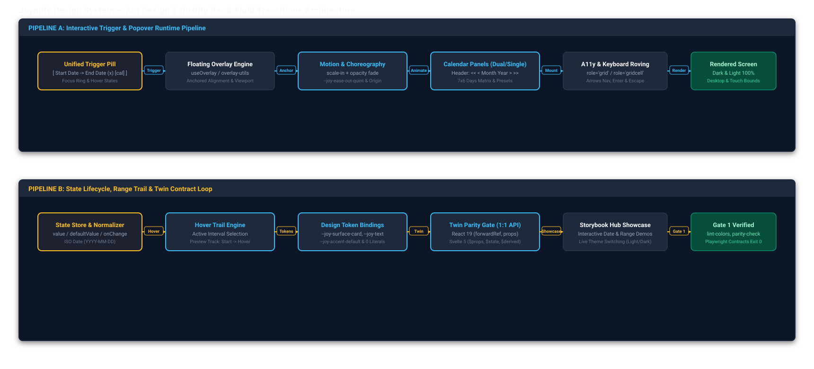

# Joymify Design System — Ant Design 5 Quality Bar & Fluid Transitions Specification

## 1. Executive Summary & Problem Space

Enterprise UI standards set by **Ant Design 5** establish a high bar for component aesthetics, micro-transitions, keyboard accessibility, and state resilience. 

Visual inspection of Joy Design reveals key gaps:
1. **DatePicker & DateRangePicker Deficiencies**:
   - `DatePicker` was implemented as a raw browser `<input type="date">` with an overlaid SVG icon. In Chromium, this produces duplicate calendar icons (`::-webkit-calendar-picker-indicator` plus the SVG icon) and triggers an unstyled, stark-white OS popover in dark theme.
   - `DateRangePicker` was implemented as two disjoint text inputs separated by a literal "to" text string, rather than a unified interactive trigger pill with linked dual-calendar panels and hover-range trail styling.
2. **Overlay & Motion Abruptness**:
   - Popovers, dropdowns, and modals lack cubic-bezier entrance/exit physics (`--joy-ease-out-quint`) and unmount abruptly without exit animations.
   - Navigation components (`Tabs`, `Segmented`) use abrupt class swaps rather than physical sliding active ink-bars and thumb pills.
   - Form inputs lack micro-interactions (e.g. hover-revealed clear triggers `(x)` and soft focus transitions).

This specification defines the architectural blueprint to elevate Joy Design to match and exceed Ant Design 5 standards across both Svelte 5 and React 19 frameworks, with 100% semantic token compliance and zero color literals.

---

## 2. Architecture Overview & Decoupled Execution Flows

The elevation architecture separates the fast real-time user trigger pipeline from the deep state lifecycle, hover trail, and token binding loop:



```schematic
+---------------------------------------------------------------------------------------------------------+
| PIPELINE A: Interactive Trigger & Popover Runtime                                                       |
|                                                                                                         |
|  [ Unified Trigger Pill ]  --->  [ Floating Overlay Engine ]  --->  [ Motion Choreography ]             |
|   (Start -> End (x) cal)          (Fixed Anchored Positioning)        (--joy-ease-out-quint scale-in)   |
|                                                                                    |                    |
|                                  [ Accessibility Roving A11y ] <--- [ 7x6 Calendar Matrix ]             |
|                                   (role='grid', Arrows, Enter)       (<< < Month Year > >>, Presets)    |
+---------------------------------------------------------------------------------------------------------+
                                                     |
                                                     v
+---------------------------------------------------------------------------------------------------------+
| PIPELINE B: State Lifecycle, Range Trail & Twin Contract Loop                                           |
|                                                                                                         |
|  [ Date State Store ]      --->  [ Hover Trail Engine ]       --->  [ Semantic Token Layer ]            |
|   (ISO YYYY-MM-DD Normalizer)     (Active Interval Calculation)       (100% --joy-* Tokens, 0 Literals) |
|                                                                                    |                    |
|                                  [ Storybook Hub & Playwright ]<--- [ Twin Parity Gate ]                |
|                                   (100% Pass, Dark/Light Visual)     (Svelte 5 Runes & React 19 Parity) |
+---------------------------------------------------------------------------------------------------------+
```

---

## 3. Date & Range Picker Specification

### 3.1 Trigger Input Architecture

Instead of native `<input type="date">`, DatePicker and DateRangePicker utilize custom interactive trigger containers:

- **Single DatePicker Trigger**:
  - Container `.joy-date-picker`: displays formatted date string (e.g. `2026-09-19`) with placeholder `Select date`.
  - Suffix slot contains interactive clear button `(x)` on hover (when value present) and calendar icon.
  - Border and focus ring respond to `:focus-within` using `--joy-focus-ring`.
  - `error` and `disabled` states fully tokenized.
- **DateRangePicker Unified Pill Trigger**:
  - Container `.joy-date-range-picker`: single unified pill enclosing `[ Start Date ]  →  [ End Date ]  (x)  [cal]`.
  - Active input segment highlighted with subtle background accent (`--joy-surface-subtle`).
  - Single clear button `(x)` clears both start and end dates.
  - Seamless wrapper focus ring across the entire compound control.

### 3.2 Calendar Panel & Grid Geometry

The calendar overlay panel renders an accessible ARIA grid:
- **Header**:
  - Navigation controls: `<<` (previous year, -12 months), `<` (previous month), month/year label, `>` (next month), `>>` (next year, +12 months).
  - Quick-switch: clicking Month/Year label toggles fast year/month selection matrix.
- **Days Matrix (7 Columns x 6 Rows)**:
  - Weekday row: `Su`, `Mo`, `Tu`, `We`, `Th`, `Fr`, `Sa`.
  - 42 total day cells covering current month and leading/trailing days from adjacent months.
  - Out-of-month days: styled with `--joy-text-muted` and lighter opacity.
  - Current day ("Today"): highlighted with a subtle border ring or dot indicator.
  - Selected day: filled accent pill (`--joy-accent-default` background with `--joy-accent-contrast` text).
- **DateRangePicker Dual Panels & Range Hover Trail**:
  - Side-by-side dual calendars: Panel 1 displays Month $N$, Panel 2 displays Month $N+1$. Navigation automatically synchronizes or steps individually.
  - **Range Hover Trail**: When start date is selected, hovering over subsequent day cells dynamically highlights the connecting track (`--joy-accent-subtle`) between start and current cursor position before click.
  - Range edges: Start date gets rounded left pill, End date gets rounded right pill, intermediate days receive contiguous rectangle highlight.
- **Footer & Presets**:
  - Single DatePicker: "Today" quick-select action.
  - RangePicker: Financial / enterprise preset chips: `Last 7 Days`, `Last 30 Days`, `Month to Date (MTD)`, `Year to Date (YTD)`.

---

## 4. Motion, Transition & Visual Polish Engine

### 4.1 Tokenized Transition Curves

We introduce enhanced motion curve tokens to `packages/tokens/src/tokens.json`:
- `--joy-ease-out-quint: cubic-bezier(0.23, 1, 0.32, 1)` (Ant Design signature decelerating curve for floating panels).
- `--joy-ease-in-out-quint: cubic-bezier(0.86, 0, 0.07, 1)` (fluid sliding ink-bars and thumb morphs).
- `--joy-duration-popover: 180ms`.

### 4.2 Popover & Overlay Entrance / Exit Choreography

- **Keyframes**:
  ```css
  @keyframes joy-popover-enter {
    from {
      opacity: 0;
      transform: scale(0.96) translateY(-4px);
    }
    to {
      opacity: 1;
      transform: scale(1) translateY(0);
    }
  }
  ```
- **Backdrop Blurs**: Modals and Drawers apply `backdrop-filter: blur(4px)`.
- **Dynamic Origin**: Dropdowns and popovers adjust `transform-origin` based on placement (top vs bottom).

### 4.3 Navigation & Data Display Fluidity

- **Tabs Ink-Bar**: Active indicator rendered as an absolutely positioned `.joy-tabs__ink-bar` transitioning `transform: translateX(...)` and `width` dynamically using `--joy-duration-normal` and `--joy-ease-out-quint`.
- **Segmented Thumb**: Active segment thumb pill slides smoothly across items with springy deceleration.
- **Table Scroll Depth**: Fixed sticky columns display a progressive drop shadow when scrolled off edge.
- **Progress Stripes**: Indeterminate and active progress bars feature animated striped patterns (`@keyframes joy-progress-stripes`).

---

## 5. Token Contract & Theme Invariants

Every element strictly binds to semantic `--joy-*` tokens:

| Element Role | Semantic Token |
| :--- | :--- |
| Overlay Surface | `--joy-surface-overlay` / `--joy-surface-card` |
| Day Cell Hover | `--joy-surface-hover` |
| Selected Day Cell | `--joy-accent-default` (Fill) + `--joy-accent-contrast` (Text) |
| Range Track Highlight | `--joy-accent-subtle` |
| Out-of-Month Dates | `--joy-text-muted` |
| Calendar Separator | `--joy-border-default` |
| Trigger Focus Ring | `--joy-focus-ring` |
| Fast Year/Month Chevrons | `--joy-text-secondary` (Hover: `--joy-text-primary`) |

Zero hardcoded hex values, `rgb()`, or `hsl()` literals are permitted outside `packages/tokens/src/tokens.json`.

---

## 6. Svelte 5 / React 19 Parity & A11y Standards

### 6.1 Twin Parity Contract

`scripts/parity-check.mjs` enforces exact property and type signature parity:
- **`DatePickerProps`**:
  `value?: string`, `defaultValue?: string`, `placeholder?: string`, `disabled?: boolean`, `error?: boolean`, `size?: 'sm' | 'md' | 'lg'`, `format?: string`, `onChange?: (date: string) => void`, `allowClear?: boolean`.
- **`DateRangePickerProps`**:
  `value?: [string, string] | { start: string; end: string }`, `defaultValue?: ...`, `placeholder?: [string, string]`, `disabled?: boolean`, `error?: boolean`, `size?: 'sm' | 'md' | 'lg'`, `presets?: Array<{ label: string; value: [string, string] }>`, `onChange?: (range: ...) => void`.

### 6.2 Accessibility Matrix (WCAG 2.2 AA)

- Popover container carries `role="dialog"`, `aria-modal="false"`, `aria-label="Choose Date"`.
- Calendar table carries `role="grid"`.
- Day cells carry `role="gridcell"`, `aria-selected="true|false"`, `aria-current="date"` (for today).
- Full keyboard roving:
  - `ArrowLeft` / `ArrowRight`: Navigate previous / next day.
  - `ArrowUp` / `ArrowDown`: Navigate previous / next week (-7 / +7 days).
  - `PageUp` / `PageDown`: Jump previous / next month.
  - `Shift + PageUp` / `Shift + PageDown`: Jump previous / next year.
  - `Enter` / `Space`: Select focused date.
  - `Escape`: Close popover and return focus to trigger.

---

## 7. Phased Implementation Roadmap

1. **Phase 1: Token & Motion Foundation**
   - Add Ant Design 5 motion curve tokens (`--joy-ease-out-quint`) and calendar panel token classes in `packages/tokens/build.js`.
   - Verify 0 color violations with `scripts/lint-colors.sh`.
2. **Phase 2: DatePicker & DateRangePicker Core Implementation**
   - Build custom calendar popover, 7x6 month grid, header navigation chevrons, and keyboard roving in Svelte 5 (`DatePicker.svelte`, `DateRangePicker.svelte`).
   - Build matching React 19 twin components (`DatePicker.tsx`, `DateRangePicker.tsx`) with byte-for-byte prop parity.
   - Implement unified trigger pill and dual-month range hover trail.
3. **Phase 3: Navigation & Micro-Interactions Upgrade**
   - Implement fluid sliding ink-bar in `Tabs` and sliding thumb in `Segmented`.
   - Add hover-reveal clear buttons `(x)` to inputs.
4. **Phase 4: Storybook Hub Showcase & Visual Verification**
   - Overhaul `view-date-picker` in `apps/storybook-hub/build.js` with interactive single and range pickers, financial backtest window presets, and dark/light switching.
   - Author comprehensive Playwright test suite `apps/storybook-hub/tests/antd5-parity.spec.ts`.
   - Run Gate 1 Precheck (`scripts/precheck.sh`) and capture visual evidence screenshots in dark and light modes.
   - Update `README.md` and documentation.
