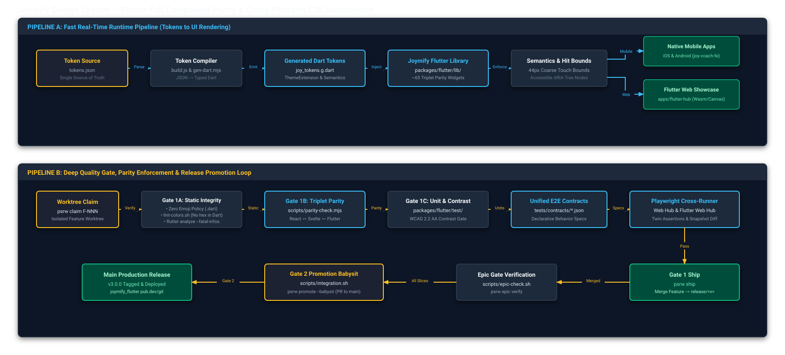

# Joymify Design System — Flutter Parity Ecosystem, Quality Gate & Sharable E2E Architecture

> **Document Type:** System Architecture & Design Specification  
> **Status:** Draft / Ready for Epic Inception  
> **Target Release:** `release/3.00` (Multi-Platform Parity Milestone)  
> **Author:** Antigravity Autonomous Agent  
> **Date:** 2026-10-05  

<div class="metric-grid">
  <div class="metric-tile">
    <div class="metric-label">Target Frameworks</div>
    <div class="metric-val">3</div>
    <div class="metric-desc">React 19, Svelte 5, Flutter 3.32+</div>
  </div>
  <div class="metric-tile">
    <div class="metric-label">Component Parity Inventory</div>
    <div class="metric-val">65+</div>
    <div class="metric-desc">Primitives, Forms, Feedback, Layout, Brand</div>
  </div>
  <div class="metric-tile">
    <div class="metric-label">Quality Gate Target</div>
    <div class="metric-val">Gate 1 &amp; 2</div>
    <div class="metric-desc">Zero Emoji, Color Lint, Parity, WCAG AA, E2E</div>
  </div>
  <div class="metric-tile">
    <div class="metric-label">E2E Contract Sharing</div>
    <div class="metric-val">100%</div>
    <div class="metric-desc">Dual-Target Playwright over Web &amp; Flutter Canvas</div>
  </div>
</div>

---

## 1. Executive Summary & Vision

Joymify Design System (`joy-design`) currently provides complete parity between Svelte 5 and React 19 driven by design tokens from `@joymify/tokens`. As Joymify expands its product suite across mobile applications (e.g. `joy-coach-fe` on mobile devices, high-frequency trader mobile views in `quant-fe`, and investor monitoring in `joymify-portal`), engineers need the exact same design system instantly and automatically available in Flutter.

This specification designs the end-to-end architecture to:
1. **Establish the Flutter Ecosystem (`packages/flutter`)**: First-class monorepo package delivering idiomatic, type-safe Flutter widgets mirroring React and Svelte APIs.
2. **Automate the Token Pipeline to Dart**: Transform `tokens.json` into typed Dart tokens (`joy_tokens.g.dart`) with zero color literals in component source code.
3. **Extend Quality Gates to Triple-Framework Parity**: Expand Gate 1 (`scripts/precheck.sh`) and Gate 2 (`scripts/integration.sh`) to enforce zero emojis, color token integrity, Dart strong analysis, and triple parity across React, Svelte, and Flutter.
4. **Deliver Unified Sharable E2E Tests**: A declarative contract test suite executed via Playwright against both the Web Storybook Hub and the Flutter Web Showcase, verifying identical interaction semantics, focus outlines, 44px touch targets, and visual regression under 1.5% delta.
5. **Execute via the Full PSRW Lifecycle**: From `psrw new-release` through `psrw epic open`, `fanout`, `refine`, isolated worktree `claim`, Gate 1 `ship`, and Gate 2 `promote --babysit`.

---

## 2. Decoupled Architecture

Per our production-grade architectural standards, the system decouples into two independent execution flows:
1. **Pipeline A (Fast Real-Time Runtime Pipeline)**: Token compilation into Dart types, runtime widget tree generation, semantic geometry and touch bound enforcement, delivering to native mobile and web canvases.
2. **Pipeline B (Deep State, Quality Gate & Release Promotion Loop)**: Static analysis, color token linting, parity verification, declarative E2E Playwright contracts execution, and the PSRW release promotion lifecycle.

<div class="callout info">
  <strong>Decoupled Architecture Diagram</strong><br/>
  The complete architecture is modeled in <a href="file:///Users/pasitnusso/workspace/repos/joy-design/docs/superpowers/specs/2026-10-05-flutter-parity-architecture.drawio">2026-10-05-flutter-parity-architecture.drawio</a> and structurally verified with <code>validate.py --score</code> (Score: 0, 0 overlaps, 0 crossings).
</div>



<div class="schematic">
+---------------------------------------------------------------------------------------------------------------------------------------+
| PIPELINE A: Fast Real-Time Runtime Pipeline (Tokens to UI Rendering)                                                                  |
+---------------------------------------------------------------------------------------------------------------------------------------+
  [ tokens.json ]             Single source of truth for all primitive and semantic design tokens
         |
         v (Parse Schema)
  [ build.js & gen-dart.mjs ] Token compilation pipeline transforming JSON to strongly-typed Dart code
         |
         v (Emit Typed Code)
  [ joy_tokens.g.dart ]       Flutter ThemeExtension&lt;JoyThemeTokens&gt; supporting Light &amp; Dark semantic palettes
         |
         v (Inject Semantic Tokens)
  [ packages/flutter/lib/ ]   65+ Joymify component widgets (JoyButton, JoyInput, JoySelect, JoyModal, JoyTable...)
         |
         v (Enforce Geometry)
  [ Semantics &amp; Touch Bounds ] Minimum 44x44px touch targets on coarse pointers, accessible ARIA-equivalent roles
         |
         +-------------------------------------+-------------------------------------+
         |                                                                           |
         v                                                                           v
  [ Native Mobile (iOS / Android) ]                           [ Flutter Web Showcase (apps/flutter-hub) ]
  (Direct dependency for Joymify mobile apps)                 (Compiles to Wasm/Canvas for cross-platform E2E)
</div>

---

## 3. Token Compilation Pipeline (`tokens.json` → Dart)

### 3.1 Token Contract Principles
- **Zero Color Literals**: In compliance with `AGENTS.md` and `DESIGN.md`, no raw hex (`Color(0xFF...)`) or Flutter stock colors (`Colors.blue`, `Colors.amber`) are permitted in component source code. All colors are accessed through semantic tokens:
  ```dart
  final theme = context.joyTheme;
  final bg = theme.surface.canvas;
  final fg = theme.text.primary;
  final accent = theme.accent.primary;
  ```
- **The Only Exception**: The generated file `packages/flutter/lib/src/tokens/joy_tokens.g.dart` is the sole file permitted to contain color literals.
- **Dark is Designed, Not Derived**: Flutter utilizes a custom `ThemeExtension<JoyThemeTokens>` supporting seamless transitions between light and dark modes with dedicated semantic color sets.

### 3.2 Compilation Output
The script `packages/tokens/scripts/gen-dart-tokens.mjs` generates:
```dart
// GENERATED CODE - DO NOT MODIFY BY HAND
// Source: packages/tokens/src/tokens.json

import 'package:flutter/material.dart';

class JoyColors {
  JoyColors._();
  // Primitives
  static const Color navy50 = Color(0xFFF0F4F8);
  static const Color navy900 = Color(0xFF0D1527);
  static const Color gold500 = Color(0xFFE5A919);
  // ...
}

@immutable
class JoySurfaceTokens {
  final Color canvas;
  final Color card;
  final Color sunken;
  final Color overlay;
  const JoySurfaceTokens({required this.canvas, required this.card, required this.sunken, required this.overlay});
}

@immutable
class JoyTextTokens {
  final Color primary;
  final Color secondary;
  final Color muted;
  final Color inverse;
  const JoyTextTokens({required this.primary, required this.secondary, required this.muted, required this.inverse});
}

@immutable
class JoyThemeTokens extends ThemeExtension<JoyThemeTokens> {
  final JoySurfaceTokens surface;
  final JoyTextTokens text;
  final JoyBorderTokens border;
  final JoyAccentTokens accent;
  final JoyStatusTokens status;
  final JoySpacingTokens spacing;
  final JoyRadiusTokens radius;
  final JoyElevationTokens elevation;
  final JoyMotionTokens motion;

  const JoyThemeTokens({
    required this.surface,
    required this.text,
    required this.border,
    required this.accent,
    required this.status,
    required this.spacing,
    required this.radius,
    required this.elevation,
    required this.motion,
  });

  static final JoyThemeTokens light = JoyThemeTokens(/* ... resolved light tokens ... */);
  static final JoyThemeTokens dark = JoyThemeTokens(/* ... resolved dark tokens ... */);

  @override
  JoyThemeTokens copyWith({/* ... */}) => /* ... */;

  @override
  JoyThemeTokens lerp(ThemeExtension<JoyThemeTokens>? other, double t) => /* ... */;
}

extension JoyThemeContext on BuildContext {
  JoyThemeTokens get joyTheme => Theme.of(this).extension<JoyThemeTokens>() ?? JoyThemeTokens.light;
}
```

---

## 4. Monorepo Integration & Flutter Package Structure

The Flutter package lives directly inside the existing Joymify monorepo at `packages/flutter/`:

```
joy-design/
├── packages/
│   ├── tokens/                  # Design tokens & generator scripts
│   │   ├── src/tokens.json
│   │   └── scripts/gen-dart-tokens.mjs
│   ├── icons/                   # Vector icons compiled for Svelte, React, Flutter
│   ├── react/                   # React 19 implementation
│   ├── svelte/                  # Svelte 5 runes implementation
│   └── flutter/                 # Flutter 3.32+ implementation (joymify_flutter)
│       ├── pubspec.yaml
│       ├── analysis_options.yaml
│       ├── lib/
│       │   ├── joymify_flutter.dart  # Barrel export
│       │   └── src/
│       │       ├── tokens/joy_tokens.g.dart
│       │       ├── components/
│       │       │   ├── general/ (JoyButton, JoyIcon, JoyText)
│       │       │   ├── forms/   (JoyInput, JoySelect, JoyCheckbox...)
│       │       │   ├── feedback/(JoyModal, JoyAlert, JoyToast...)
│       │       │   ├── display/ (JoyTable, JoyAvatar, JoyTag...)
│       │       │   ├── layout/  (JoySpace, JoyFlex, JoyDivider...)
│       │       │   └── domain/  (JoyVoiceCard, JoyCourtRadar...)
│       └── test/
│           ├── tokens_test.dart
│           ├── contrast_test.dart
│           └── components/
├── apps/
│   ├── storybook-hub/           # Web showcase (React + Svelte previews)
│   └── flutter-hub/             # Flutter Web showcase (Wasm / CanvasKit)
└── tests/
    └── contracts/               # Shared declarative E2E test specs (*.contract.json)
```

---

## 5. Component Registry & Tiered Mobile Scope (91 Components)

The Joymify Design System registry in `scripts/parity-check.mjs` tracks **91 components**. To ensure pragmatic, high-velocity delivery without burdening mobile applications with desktop-only website furniture, components are categorized into three explicit tiers:

### 5.1 Tier 1: Required for Flutter Mobile & Trading (~62 Components)
Must achieve 100% triplet parity across React, Svelte, and Flutter with matching props and states:

| Category | Components | Flutter Implementation Details |
| :--- | :--- | :--- |
| **Primitives & General** | `Button`, `Icon`, `Typography` | `JoyButton` (solid/outline/ghost/danger/link), `JoyIcon` (vector precompiled), `JoyText` |
| **Form Controls** | `Input`, `InputNumber`, `Select`, `Checkbox`, `Switch`, `RadioGroup`, `Slider`, `Rate`, `Segmented`, `Form`, `FormItem`, `DatePicker`, `TimePicker`, `DateRangePicker` | Full state matrix, controllers for text, bottom-sheet overlays on mobile, 44px hit bounds |
| **Overlays & Dialogs** | `Modal`, `Drawer`, `Popconfirm`, `Tooltip`, `Dropdown` | Safe area integration, on-screen keyboard handling, Android back gesture support |
| **Feedback** | `Alert`, `Message`, `Toast`, `Notification`, `Progress`, `Result`, `Skeleton`, `Spin` | `JoyScope` overlay host provider, auto-dismiss, token-driven status colors |
| **Navigation** | `Breadcrumb`, `Menu`, `Pagination`, `Steps`, `Tabs` | Direction-aware layouts, touch scrolling, tab switches |
| **Layout** | `Space`, `Flex`, `Splitter`, `Divider` | `JoySpace`, `JoyFlex`, `JoyDivider` with gap tokens |
| **Data Display** | `Avatar`, `AvatarGroup`, `Badge`, `Tag`, `EmptyState`, `Timeline`, `Image`, `ImagePreview`, `Table`, `Statistic`, `StatCard`, `MetricTile` | Virtualized `JoyTable` with lazy column rendering, status chips, metric cards |
| **Charts (Trading)** | `BarChart`, `LineChart`, `CandlestickChart`, `TrendLine` | High-performance custom painter behind RepaintBoundary, gesture zooming |
| **Domain & Sports** | `VoiceCard`, `CourtRadar`, `MatchScoreboard`, `PerformanceFigure`, `PerformanceBars`, `DenseRow`, `MonoChip`, `ChronometerDial`, `TelemetryStrip`, `CommandIsland` | Sports canvas radar, audio waveforms, telemetry chips |
| **Brand Identity** | `BrandMark`, `Wordmark`, `Ribbon`, `BrandBanner`, `Emblem` | Vector brand assets with dynamic theme color adaptation |

### 5.2 Tier 2: Planned Later / Secondary Desktop Forms (~15 Components)
Desktop-heavy complex widgets deferred to post-v3.0 releases:
- `Mentions`, `Upload`, `TreeSelect`, `Cascader`, `Transfer`, `MarkdownEditor`, `MarkdownViewer`
- Advanced marketing sections: `HeroSection`, `CTASection`, `PricingCard`, `PricingMatrix`, `FeatureCard`, `FeatureGrid`, `BentoCard`, `BentoGrid`, `StatsSection`

### 5.3 Tier 3: Not Applicable / Website Furniture (~14 Components)
Marked `not-applicable` in component manifests (no mobile app utility):
- `SiteFooter`, `LandingPage`, `LandingAction`, `LogoCloud`, `FAQSection`, `TestimonialCard`, `Anchor`

---

## 6. Hardened Quality Gate Architecture (Gate 1 & Gate 2)

### 6.1 Gate 1: Deterministic Precheck (`scripts/precheck.sh`)
Gate 1 runs in every feature worktree prior to `psrw ship`. It is enhanced with:
1. **Zero Emoji Verification**:
   - Python UTF-32 regex check in `scripts/precheck.sh` extended to scan `.dart` files, explicitly excluding `.dart_tool/` and `build/`.
   - Rejects any raw OS emoji; all icons strictly resolve from `@joymify/icons` via `JoyIcon`.
2. **Color Token Linter (`scripts/lint-colors.sh`)**:
   - Scans `packages/flutter/lib/**/*.dart`.
   - Banned: `Color(`, `Color.from`, `HSLColor`, `HSVColor` (outside `joy_tokens.g.dart`).
   - Banned: `Colors.` and `CupertinoColors.` stock palettes.
   - Banned: `.withOpacity(`, `.withAlpha(`, `.withValues(` in component code (tokens define alpha).
   - Banned: `isDark ? a : b` conditionals (dark theme is designed, not derived in code).
3. **Dart Strong Analysis**:
   - `flutter analyze --fatal-infos --fatal-warnings` pinned to Dart 3.8.1.
4. **Component API Manifest Parity**:
   - Each component carries `manifests/<component>.json`.
   - Validates that every component marked `required` exists with synchronized prop names.
5. **Native Dart Contract Test Runner**:
   - Executes `flutter test test/contracts/` verifying behavioral JSON contracts natively.

### 6.2 Gate 2: Release Integration (`scripts/integration.sh`)
Gate 2 executes during `psrw promote --babysit` before opening the PR to `main`:
1. Compiles `packages/flutter`: `flutter pub get && flutter analyze`.
2. Compiles `apps/flutter-hub` Web showcase: `flutter build web --wasm`.
3. Runs the Playwright Flutter Web smoke test against `apps/flutter-hub` via `JoyHubBridge`.
4. Executes cross-engine geometry and token color sampling assertions.

---

## 7. Sharable Cross-Platform E2E Test Strategy

To ensure zero behavioral discrepancy between Web (React/Svelte) and Mobile (Flutter), E2E test scenarios are shared 100% via a **declarative behavioral contract engine**.

### 7.1 Architecture of Shared Contracts
Test contracts are defined declaratively in `tests/contracts/<component>.contract.json`:
```json
{
  "schema": 2,
  "component": "Button",
  "story": "button/default",
  "anchors": { "root": "joy.button.submit" },
  "cases": [
    {
      "name": "activate fires once",
      "arrange": { "props": { "variant": "solid" } },
      "act": [{ "do": "activate", "on": "root" }],
      "expect": [
        { "event": "activate", "count": 1 },
        { "semantics": { "role": "button", "label": "Submit", "enabled": true } }
      ]
    },
    {
      "name": "loading blocks activation",
      "arrange": { "props": { "loading": true } },
      "act": [{ "do": "activate", "on": "root" }],
      "expect": [
        { "event": "activate", "count": 0 },
        { "semantics": { "busy": true } }
      ]
    }
  ],
  "geometry": { "minHitTarget": { "width": 44, "height": 44, "when": "touch" } },
  "focus": { "reachableByKeyboard": true, "visibleIndicator": "sampled" },
  "adaptations": [
    { "target": "flutter", "note": "none" }
  ],
  "skip": []
}
```

### 7.2 Execution Architecture: One Contract, Three Runners

```
  [ Shared Contract Files: tests/contracts/*.contract.json ]
                    │
      ┌─────────────┴─────────────┐
      │                           │
      ▼                           ▼
  [ Playwright on Web Hub ]   [ Flutter Widget Test Runner ]  [ Playwright on Flutter Web ]
  (React & Svelte Twins)     (Reads Same JSON Natively)      (Small Smoke Subset)
      │                           │                               │
      └─────────────┬─────────────┘                               │
                    │                                             ▼
                    ▼                                    [ Gate 2: Per Release ]
          [ Gate 1: Per Feature ]
```

1. **Native Flutter Widget Test Runner (Primary Gate 1)**:
   - A Dart harness loads `*.contract.json` and executes with `testWidgets`. Direct access to semantics, exact gesture dispatch, safe areas, 44px hit bounds, and text scaling in milliseconds without browser overhead.
2. **Playwright on Web Storybook Hub (Primary Gate 1 for Web)**:
   - Executes contracts against React 19 and Svelte 5 DOM.
3. **Playwright on Flutter Web (Gate 2 Smoke Subset)**:
   - Verifies the Flutter Web Showcase (`apps/flutter-hub`) using `JoyHubBridge` (`window.__joyHub`) for hydration readiness, theme toggling, and event callback counting.

### 7.3 Three Concrete Visual Parity Checks
Instead of an arbitrary cross-rasterizer pixel diff threshold, the visual gate uses three deterministic checks:
1. **Per-Engine Baselines**: Each engine is compared strictly against its own earlier snapshot to catch regressions.
2. **Cross-Engine Geometry**: Compares bounding boxes: width, height, padding, and gaps within 1px across Web and Flutter.
3. **Cross-Engine Token Color Sampling**: Reads pixels at declared anchor points (center of surface, border edge) and asserts exact hexadecimal parity with the active semantic token value.

---

## 8. Full PSRW / PSRWF Lifecycle Across All Phases

The entire initiative is planned and executed through the complete chain of `ps-release-workflow` (`psrw`):

<div class="schematic">
+---------------------------------------------------------------------------------------------------------------------------------------+
| PSRW FULL-CHAIN RELEASE &amp; EPIC EXECUTION LIFECYCLE                                                                                    |
+---------------------------------------------------------------------------------------------------------------------------------------+
  [ Phase 0: Release Init ]
    psrw new-release 3.00                        -&gt; Mints release/3.00 branch &amp; _release worktree
  
  [ Phase 1: Epic Inception &amp; Spec ]
    psrw epic open "Flutter Parity Ecosystem"    -&gt; Mints Epic E-002, spec skeleton &amp; verification skeleton
    Commit design spec &amp; architecture diagram   -&gt; 2026-10-05-flutter-parity-architecture.drawio (Score 0)

  [ Phase 2 &amp; 3: Fanout &amp; Refinement ]
    psrw epic fanout                             -&gt; Generates slice ideas I-063 through I-067 in .claude/idea_backlog/
    psrw refine I-NNN                            -&gt; Promotes ideas to refined features F-063..F-067 with acceptance contracts

  [ Phase 4 &amp; 5: Worktree TDD &amp; Gate 1 Shipping ]
    For each wave / feature slice:
      psrw claim F-NNN                           -&gt; Opens isolated worktree _worktrees/F-NNN
      TDD red/green/refactor                     -&gt; Unit tests, widgets, tokens, 44px hit bounds
      scripts/precheck.sh                        -&gt; Gate 1: Zero emoji, color lint, parity check, types, contrast
      psrw ship                                  -&gt; Merges feature F-NNN into release/3.00

  [ Phase 6: Epic Verification Gate ]
    psrw epic verify                             -&gt; Executes scripts/epic-check.sh across full workspace
                                                 -&gt; Marks Epic E-002 verified

  [ Phase 7: Gate 2 Promotion &amp; Babysitting ]
    psrw promote --babysit                       -&gt; Runs Gate 2 scripts/integration.sh
                                                 -&gt; Opens PR release/3.00 -&gt; main
                                                 -&gt; Babysits CI rollout until pods rollout cleanly
</div>

---

## 9. Phased Wave Roadmap

The rollout is partitioned into 5 sequential waves of delivery:

- **Wave 1: Foundation, Tokens & Core Primitives (F-063)**
  - Pubspec & monorepo scaffolding for `packages/flutter`.
  - `tokens.json` to Dart compiler (`gen-dart-tokens.mjs` producing `joy_tokens.g.dart`).
  - `JoyThemeExtension`, `JoyColors`, `JoyTypography`, `JoySpacing`, `JoyRadius`, `JoyElevations`.
  - Core primitives: `JoyIcon`, `JoyText`, `JoyButton`.
  - Initial Quality Gate updates (Zero emoji for `.dart`, Dart color linting, parity checker support).
- **Wave 2: Complete Form Controls Suite (F-064)**
  - `JoyInput`, `JoyInputNumber`, `JoySelect`, `JoyCheckbox`, `JoySwitch`, `JoyRadioGroup`, `JoySlider`, `JoyRate`, `JoySegmented`.
  - `JoyForm` and `JoyFormItem` validation containers.
  - `JoyDatePicker`, `JoyTimePicker`, `JoyDateRangePicker`.
  - Minimum 44px coarse hit targets verified across all form widgets.
- **Wave 3: Navigation, Layout & Feedback Overlays (F-065)**
  - Navigation: `JoyBreadcrumb`, `JoyDropdown`, `JoyMenu`, `JoyPagination`, `JoySteps`, `JoyTabs`.
  - Layout: `JoySpace`, `JoyFlex`, `JoySplitter`, `JoyDivider`.
  - Feedback & Overlays: `JoyAlert`, `JoyDrawer`, `JoyModal`, `JoyMessage`, `JoyNotification`, `JoyPopconfirm`, `JoyProgress`, `JoyResult`, `JoySkeleton`, `JoySpin`, `JoyToast`, `JoyTooltip`.
- **Wave 4: Data Display, Domain & Analytics Components (F-066)**
  - Data Display: `JoyAvatar`, `JoyAvatarGroup`, `JoyBadge`, `JoyEmptyState`, `JoyImage`, `JoyImagePreview`, `JoyTable`, `JoyTag`, `JoyTimeline`, `JoyStatCard`, `JoyMetricTile`.
  - Domain / Sports / Quant: `JoyVoiceCard`, `JoyPerformanceFigure`, `JoyDenseRow`, `JoyMonoChip`, `JoyTrendLine`, `JoyCourtRadar`, `JoyMatchScoreboard`.
- **Wave 5: Unified Cross-Platform E2E Engine & Promotion (F-067)**
  - Declarative test contracts schema in `tests/contracts/*.json`.
  - Flutter Web showcase hub (`apps/flutter-hub`).
  - Dual-engine Playwright cross-runner testing Web Hub and Flutter Web Hub.
  - Final Gate 1 & Gate 2 verification, `psrw epic verify`, and `psrw promote --babysit`.
