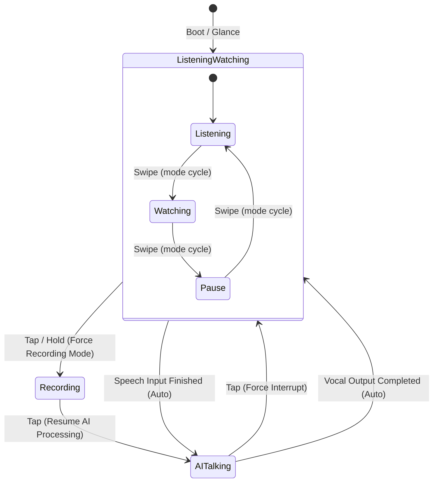

# Smart Glasses Head-Up Display (HUD): Design System Specification & UI Guidelines

<div class="topic-chip">HUD // OPTICAL AR SPECIFICATION</div>

A comprehensive design specification and ergonomic interface guideline for Smart Glasses Optical See-Through (OST) Head-Up Displays (HUD), defining the audio-visual communication state machine, temple touchpad gesture syntax, and dual-panel split monocular information architecture.

---

<div class="metric-grid">
  <div class="metric-tile">
    <div class="metric-label">Target Optics</div>
    <div class="metric-value">MicroLED Waveguide</div>
    <div class="metric-subtext">Optical See-Through (OST)</div>
  </div>
  <div class="metric-tile">
    <div class="metric-label">Field of View (FOV)</div>
    <div class="metric-value">25° Monocular</div>
    <div class="metric-subtext">Peripheral upper-right eyebox</div>
  </div>
  <div class="metric-tile">
    <div class="metric-label">Optical Luminance</div>
    <div class="metric-value">3,500 Nits</div>
    <div class="metric-subtext">High ambient daylight legibility</div>
  </div>
  <div class="metric-tile alarm">
    <div class="metric-label">Optical Black</div>
    <div class="metric-value">0% Opacity</div>
    <div class="metric-subtext">Additive RGB: #000000 = transparent glass</div>
  </div>
</div>

---

## 1. Physical & Optical Display Fundamentals

<div class="callout warn">
  <strong>Optical Additive Light Constraint:</strong> Unlike emissive OLED or backlit LCD screens, optical waveguides work exclusively via <em>additive light</em>. Pure black (<code>#000000</code> or <code>var(--joy-surface-sunken)</code> in transparent mode) does not project photons and renders as 100% transparent glass, allowing physical reality to show through. Every rendered pixel adds light onto the user's field of view.
</div>

### Optical See-Through (OST) Rendering Rules

1. **Dark Background in All Cases (Additive Physics)**:
   - In optical see-through smart glasses, photons are purely *additive*. True black (zero light emission) equals 100% transparent glass, allowing physical reality to pass through unobstructed.
   - Light or white card surfaces **do not exist** in optical waveguides: projecting white pixels across the eyebox completely occludes real-world vision, destroys see-through safety, and causes catastrophic battery depletion.
   - Therefore, the HUD visor **must maintain its optical dark background in all cases**, regardless of whether the host operating system or companion application is set to light or dark mode.

2. **Monochrome Green Architecture (P43 Phosphor, ~530nm)**:
   - Production monocular smart glasses (Vuzix, Even Realities, military aviation HUDs) use single-color green MicroLEDs.
   - **Photopic Peak V(λ)**: Human eye sensitivity peaks at 555nm (green). A green MicroLED produces 4× to 5× higher perceived luminance per milliwatt than blue or red emitters, punching through blinding 10,000-lux ambient sunlight with 3,000+ nits while preserving all-day battery life.
   - **Monochrome Luminance Ramping**:
     - *High Luminance (100% Nits)*: `var(--joy-status-success-fg)` or `var(--joy-color-green-400)` for active text, selection arrows, and live meters.
     - *Medium Luminance (60% Nits)*: `var(--joy-color-green-600)` for secondary labels and inactive telemetry.
     - *Low Luminance (20% Nits / Scrim)*: Reticle outlines and subtle container dividers.
     - *Zero Emission (0% Nits)*: Optical clear glass (background).

3. **Single-Color Symbolic State & Selection Matrix**:
   - Because single-color optics cannot use color hue (e.g. amber for warning, red for error, blue for info) to differentiate states, all interaction states must be communicated through **high-contrast geometric symbols, directional glyphs, and reverse-video typography**:

| Meaning / State | Primary Symbol / Glyph | Secondary Feedback | Optical Rationale |
| :--- | :--- | :--- | :--- |
| **Active Cursor / Selection** | `▶` (U+25B6) or `►` (U+25BA) | Reverse-video filled row (green background with black text) | Highest possible foveal pop without hue variance |
| **Checklist Pending** | `[ ]` or `□` (U+25A1) | Hollow geometric box | Distinct from filled active cursor |
| **Checklist Completed** | `[x]` or SVG vector `Check` | Strikethrough text line | Rapid cognitive discrimination |
| **Action: Delete / Reject** | `[×]` (U+00D7) | Brackets + multiplication cross | Unambiguous destructive signifier |
| **Audio: AI Talking** | `▶ TALK` (Play glyph) | Animated phosphor audio waveform bars | Indicates live voice streaming |
| **Audio: Listening** | `[~ LISTEN]` | Steady low-amplitude meter | Ambient standby indicator |
| **Audio: Paused** | `⏸ PAUSE` (U+23F8) | Frozen double bar indicator | Clear halt signal |
| **Audio: Recording Memo** | `● REC` (U+25CF) | Pulsing phosphor dot | Recording state feedback |
| **Navigation: Scroll Up/Down**| `▲` (U+25B2) / `▼` (U+25BC) | Directional arrow glyphs | Direct mapping to swipe gestures |
| **Navigation: Back / Return** | `◄ BACK` (U+25C4) | Leftward return arrow | Direct mapping to double-tap |

4. **Zero OS Emoji Policy**:
   - Monocular waveguides cannot render multi-color OS emoji bitmaps. Furthermore, operating systems render raw unicode emojis with uncontrollable colored bitmap fonts (e.g. bright blue/orange).
   - Strict rule: All icons must use scalable single-color vector SVGs from `@joymify/icons` or approved geometric unicode symbols (`▶`, `▲`, `▼`, `◄`, `►`, `■`, `□`, `×`, `●`, `⏸`, `⏹`).

---

## 2. Communication State Machine (Audio-Visual Control)

The HUD coordinates audio streaming, transcription, and assistant vocalization through a deterministic 4-state machine:



### State Definitions & Behavior

| State | Optical Indicator | Audio Channel | User Input Behavior |
| :--- | :--- | :--- | :--- |
| **`Listening`** | Active microphone icon (`Mic`), live volume wave meter | Mic beamforming ON | Captures user speech stream; automatically transitions to `AI Talking` when silence is detected. |
| **`Watching`** | Ambient eye icon (`Eye`), subtle radar pulse | Mic standby, camera vision active | Low-power ambient glance mode; monitors real-world context or waits for user trigger. |
| **`AI Talking`** | Speaker icon (`Volume2`), streaming transcript highlight | Bone-conduction speaker ON | Assistant (Claudia) is streaming synthesized speech. Single **Tap** immediately interrupts speech and returns to `Listening`. |
| **`Recording`** | Recording dot (`Activity`), elapsed duration timer | High-fidelity audio recorder ON | Forced continuous voice note or memo capture. Single **Tap** finalizes recording and submits to agent. |

---

## 3. Screen Area & Dual-Panel Information Architecture

The display area is divided horizontally into two balanced 50% split viewports designed for instantaneous peripheral eye scanning:

```
+---------------------------------------------------------------------------------------------------+
|  STATUS BAR: [Joymify HUD v2]     [BAT: 84%]     [WAVEGUIDE 60FPS]     [MIC LEVEL: |||||||...]    |
+---------------------------------------------------------------------------------------------------+
|                                 |                                                                 |
|   LEFT PANEL (50% WIDTH)        |   RIGHT PANEL (50% WIDTH)                                       |
|   Com. Mode & Conversation      |   Navigation Locator & Assist Panel                             |
|                                 |                                                                 |
|   [Voice / Watch] [Listening]   |   double tap : to Control Center                                |
|                                 |   Today Todos (tap to detail)                                   |
|   User: Hi, Show me today Todos |                                                                 |
|                                 |   > [ ] Walk 3 Km                                               |
|   Claudia: Morning, here Todos: |     [x] Prepare Meeting note                                    |
|   1. Walk 3 Km                  |     [ ] Meeting with John                                       |
|   2. Prepare Meeting note       |                                                                 |
|   3. Meeting with John          |                                                                 |
|                                 |                                                                 |
+---------------------------------------------------------------------------------------------------+
|  GESTURE CONTROLLER: [ TAP (Select/Interrupt) ]  [ DOUBLE TAP (Back) ]  [ SWIPE (Navigate) ]      |
+---------------------------------------------------------------------------------------------------+
```

### Left Panel: Communication Mode & Conversation Stream
- **Header Badge**: Displays active communication mode (`Voice` vs `Watch`) and audio state (`Listening`, `AI Talking`, `Recording`).
- **Transcript Stream**: Displays real-time streaming dialogue between `User` and `Claudia`. Text smoothly scrolls upwards, keeping the latest turn anchored at the focal reading line.

### Right Panel: Hierarchical Assist Views
The right panel provides 4 contextual views managed by temple touchpad gestures:

#### View 1: Control Center
Top-level launcher for quick assistant features:
- `> Conversation Control` (Opens gesture & audio state manual)
- `Daily Todos (1 / 5)` (Opens checklist view)
- `Notifications (2) 10 mins ago` (Recent alerts)

#### View 2: Today Todos (Checklist)
Interactive task list matching user image reference:
- Header: `Today Todos` with guidance breadcrumb `double tap : to Control Center`.
- Items:
  - `> [ ] Walk 3 Km`
  - `[x] Prepare Meeting note`
  - `[ ] Meeting with John`

#### View 3: Todo Detail & Action Tray
Contextual action tray triggered by tapping on a selected checklist item:
- Header: `Today Todos > Walk 3 Km` with guide `double tap : to back`.
- Options:
  - `> [ Mark done ]`
  - `[ Mark not done ]`
  - `[ Delete ]`

#### View 4: Communication Control Guide
Interactive help overlay detailing audio state transitions and gesture bindings:
- `tap : to Interrupt (state machine: - interrupt, - record, - resume AI talking)`
- `swipe : to switch to pause > watch mode [listen <-> pause <-> watch]`

---

## 4. Temple Touchpad Gesture Syntax

Smart glasses rely on a capacitive touch strip located on the right temple frame. The interaction syntax is strictly deterministic:

<div class="row two">
  <div class="callout action">
    <strong>Single Tap (Primary Action)</strong>
    <ul>
      <li><strong>While AI Talking</strong>: Immediately forces audio interruption; agent stops vocalizing and resumes listening.</li>
      <li><strong>On List Item</strong>: Opens child detail tray or toggles item state.</li>
      <li><strong>In Action Tray</strong>: Executes selected command (e.g. Mark Done).</li>
    </ul>
  </div>
  <div class="callout idea">
    <strong>Double Tap (Back / Escape)</strong>
    <ul>
      <li><strong>From Action Tray</strong>: Returns to Today Todos checklist.</li>
      <li><strong>From Checklist / Guide</strong>: Returns to root Control Center.</li>
      <li><strong>From Control Center</strong>: Collapses assist panel to minimalist ambient glance.</li>
    </ul>
  </div>
</div>

<div class="row two">
  <div class="callout metric">
    <strong>Swipe Forward / Backward</strong>
    <ul>
      <li><strong>List Navigation</strong>: Moves cursor selection arrow (<code>&gt;</code>) up and down across menu items.</li>
      <li><strong>In Com Control</strong>: Cycles communication modes between <code>[listen &harr; pause &harr; watch]</code>.</li>
    </ul>
  </div>
  <div class="callout warn">
    <strong>Hold / Long Press (&gt;600ms)</strong>
    <ul>
      <li>Forces instant <strong>Recording Mode</strong> for hands-free voice notes.</li>
      <li>Release or single tap stops recording and initiates agent task dispatch.</li>
    </ul>
  </div>
</div>

---

## 5. Ergonomics, Eye-Box & Cognitive Safety

<div class="callout danger">
  <strong>Peripheral Cognitive Occlusion Hazard:</strong> Displaying dense UI in the user's primary line of sight while walking or operating machinery creates severe tunnel vision. The HUD must obey strict cognitive safety laws:
</div>

1. **Eye-Box Positioning**:
   - The HUD cluster is calibrated to sit in the upper-right peripheral quadrant (+12° horizontal, +8° vertical), allowing the central foveal view to remain 100% unobstructed.
2. **Glanceability Index**:
   - Any screen must be scannable in **< 1.2 seconds**.
   - No paragraphs longer than 3 lines.
   - Text sizing: Minimum `14px` rendered font size at 1m virtual focal distance (approximately 28 arcminutes).
3. **Contrast Guarantee**:
   - Minimum 4.5:1 contrast ratio against 1,000-lux ambient real-world scenes.
   - High-contrast luminescent vector icons from `@joymify/icons` with 1.5px stroke width.

---

## 6. Token Contract & Component Mapping

All HUD components strictly resolve through Joymify Design System semantic tokens:

| Element | Semantic Token | Optical Rationale |
| :--- | :--- | :--- |
| **HUD Visor Frame** | `--joy-border-default` | Delicate 1px structural framing without blocking light |
| **Primary Glyphs** | `--joy-text-primary` | High-luminescence phosphor white for rapid readability |
| **Accent Highlights** | `--joy-accent-default` | Warm gold for active cursor (`>`) and selected items |
| **Active Audio State** | `--joy-status-success-fg` | Emerald phosphor for active microphone capture |
| **Interrupted / Alert** | `--joy-status-warning-fg` | Amber phosphor for pause and recording alerts |
| **Optical Black** | `--joy-surface-sunken` | 100% transparent in waveguide; 85% translucent in simulator |

---

<div class="callout success">
  <strong>Implementation Verification:</strong> The interactive simulator demonstrating this specification is hosted in Storybook Hub under view <code>#view-glasses-hud</code>. Automated visual regression tests are registered in <code>apps/storybook-hub/tests/glasses-hud.spec.ts</code>.
</div>
