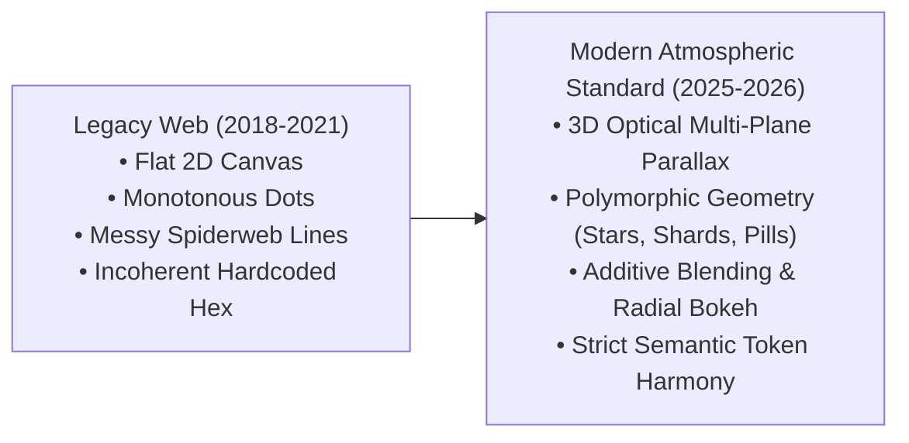

# Deep Research & Design System: Particle Animation Variants for High-Impact Landing Page Heroes

<div class="callout info">
<strong>Executive Summary:</strong> Modern hero particle systems (Linear, Stripe, Raycast, Vercel, Apple Keynote) have evolved from flat screensaver "spiderweb" nets into <strong>atmospheric depth engines</strong>. This report delivers deep internet research on modern particle trends, optical depth physics, rendering formulas, and <strong>6 production-grade design variants</strong> spanning custom color palettes, polymorphic shapes, multi-plane size hierarchies, and interactive physical dynamics.
</div>

<div class="metric-grid">
<div class="metric-tile">
<span class="metric-label">Target Visual Impact</span>
<span class="metric-value">6 Archetypes</span>
<span class="metric-desc">Luxury FinTech, DevTools AI, Apple Titanium, Cyber HUD, Solar Plasma, Swiss Grid</span>
</div>
<div class="metric-tile">
<span class="metric-label">Optical Planes</span>
<span class="metric-value">3 Layers</span>
<span class="metric-desc">Macro Foreground Bokeh, Sharp Midground Focal Plane, Infinite Micro Starfield</span>
</div>
<div class="metric-tile">
<span class="metric-label">Geometry Types</span>
<span class="metric-value">7 Shapes</span>
<span class="metric-desc">Pills, 4-Point Stars, Diamond Shards, Radial Orbs, Data Glyphs, Rings, Halftones</span>
</div>
<div class="metric-tile">
<span class="metric-label">Accessibility & Perf</span>
<span class="metric-value">60 FPS / AA</span>
<span class="metric-desc">Zero FOUC, text contrast cutout mask, prefers-reduced-motion still frame</span>
</div>
</div>

---

## <span class="topic-chip">1. Deep Internet Research: Current State of the Art (2026)</span>

In analyzing award-winning landing pages (Awwwards Site of the Year nominees, FWA winners, Linear, Raycast, Vercel, Stripe Sessions, Apple Keynote microsites, and Lusion 3D canvases), modern particle systems adhere to four fundamental architectural shifts:

### A. The Evolution: From "Screensaver Spiderwebs" to "Atmospheric Volume"



1. **Rejection of Spiderwebs**: Connecting lines between nearby dots ("particles.js default") creates severe cognitive noise and slices through typography. Elite landing pages completely discard connecting lines in favor of **independent depth-oriented kinetic bodies**.
2. **Text Legibility as First-Class Constraint**: A hero section's primary conversion job is headline clarity. Particles passing directly over text create contrast degradation. Modern canvas engines use live DOM text bounding-box occlusion masks (`destination-out`) so the copy sits safely on clear canvas.
3. **Multi-Plane Focal Physics (Bokeh & Parallax)**: Human vision perceives depth through atmospheric perspective. If every particle is sharp and moves at the same speed, the canvas appears flat. Modern engines split the system into **Foreground Macro Bokeh**, **Midground Action Plane**, and **Background Dust**.
4. **Fluid Ambient Physics**: Instead of rigid linear velocity, modern particles ride smooth Perlin/curl noise fields, harmonic sine wave sways, or gravitational lens distortion when interacting with the pointer.

---

## <span class="topic-chip">2. Optical Hierarchy: The 3-Tier Depth Architecture</span>

<div class="schematic">
+---------------------------------------------------------------------------------+
| CAMERA PERSPECTIVE & THREE-PLANE OPTICAL HIERARCHY                              |
|                                                                                 |
|  [Foreground Bokeh]          [Midground Focal Plane]     [Background Starfield] |
|   Z: +100 to +180             Z: -40 to +60               Z: -80 to -160        |
|   Scale: 1.4x - 1.8x          Scale: 0.9x - 1.2x          Scale: 0.5x - 0.7x    |
|   Radius: 24px - 48px         Size: 3px - 16px            Size: 0.8px - 1.5px   |
|   Soft Radial Falloff         Crisp Edges & High Contrast Sub-pixel Stardust    |
|   Fast Parallax Velocity      Interactive Cursor Steering Slow Ambient Drift    |
|   Alpha: 0.05 - 0.12          Alpha: 0.70 - 0.95          Alpha: 0.15 - 0.35    |
+---------------------------------------------------------------------------------+
</div>

<div class="row two">
<div>

### Plane 1: Background Dust (Volume)
- **Count**: 55–65% of total particle volume.
- **Size**: Microscopic 0.8px to 1.5px.
- **Motion**: Extremely slow, laminar upward drift with subtle harmonic sine sway.
- **Visuals**: Low opacity (0.15 to 0.30). Acts as an atmospheric starfield or ambient dust motes catching ambient light.
</div>
<div>

### Plane 2: Midground Focal (Interaction)
- **Count**: 30–35% of total volume.
- **Size**: Crisp, legible geometries (3px to 18px).
- **Motion**: Direct response to cursor velocity, mouse repulsion force-field, and click bursts.
- **Visuals**: Full brand accent colors, sharp geometric contours, high contrast.
</div>
</div>

### Plane 3: Foreground Bokeh (Cinematic Lens)
- **Count**: Only 5–8 total particles.
- **Size**: Enormous (24px to 64px).
- **Motion**: Rapid parallax displacement tied to pointer position, giving a handheld camera sensation.
- **Visuals**: Soft radial gradient or canvas gaussian blur (`filter: blur(8px)`) with ultra-low alpha (0.04 to 0.12). They softly wash across the viewport without obscuring content.

---

## <span class="topic-chip">3. Comprehensive Catalog of 6 Hero Particle Variants</span>

Below are six production-ready design archetypes specifically designed to pair with modern landing page heroes, complete with color hex codes, semantic token mappings, geometry specifications, and physics dynamics.

---

### Variant 1: "Obsidian & 24K Gold" — Luxury FinTech & High-Frequency Trading

<div class="callout idea">
<strong>Brand Alignment:</strong> Matches the Joymify Design System's navy canvas and gold accents. Engineered for dense trading desks, executive enterprise platforms, wealth management, and high-trust SaaS.
</div>

<div class="row two">
<div>

#### Color Palette
- **Canvas Base**: Midnight Navy (`#0D1624` / `--joy-surface-canvas-dark`)
- **Primary Core**: Radiant 24K Gold (`#DAB362` / `--joy-accent-default-dark`)
- **Luminous Glint**: Champagne Sunburst (`#F8E7B9` / `--joy-accent-hover-dark`)
- **Depth Halo**: Burnished Bronze (`#856515` / `--joy-accent-active-dark` at 35% alpha)
- **Atmospheric Starlight**: Slate Blue Tint (`#566A87` / `--joy-border-default-dark` at 20% alpha)
</div>
<div>

#### Shape & Size Matrix
- **50% Kinetic Speed Pills**: 3px thickness × 12px–24px length, rounded caps (`roundRect`), aligned along vertical flow vectors.
- **35% Precision Nano-Orbs**: 1.5px–3px crisp circles.
- **15% 4-Point Financial Stars**: 6px–10px diamond cross glints with dynamic phase-based opacity twinkle.
- **5 Foreground Bokeh Discs**: 28px–45px soft radial gold glow.
</div>
</div>

#### Physics & Interaction
- **Antigravity Laminar Flow**: Constant steady upward float (`vy = -0.2 to -0.65`).
- **Rotational Inertia**: Pills subtly tilt as they float (`omega = ±0.015 rad/frame`).
- **Magnetic Force Field**: Cursor exerts smooth repulsion within 180px radius; pills align their angle tangentially to the mouse deflection vector.
- **Click Shockwave**: Radial impulse expanding outwards, imparting rotational spin and velocity bursts.

---

### Variant 2: "Deep Space Cosmos & Aurora Cyan" — Modern DevTools & AI Infrastructure

<div class="callout info">
<strong>Aesthetic Style:</strong> Linear, Supabase, Vercel Ship, and Raycast aesthetic. Conveys hyper-speed, intelligence, developer infrastructure, and next-generation cloud architectures.
</div>

<div class="row two">
<div>

#### Color Palette
- **Canvas Base**: Pitch Void Black (`#030712`)
- **Primary Core**: Electric Hyper Cyan (`#06B6D4` / `#22D3EE`)
- **Secondary Spectrum**: Neon Violet Aurora (`#8B5CF6` / `#A78BFA`)
- **Starlight Specular**: Diamond Pure White (`#FFFFFF`) with cyan fringe
- **Deep Nebula Wash**: Indigo Space Dust (`#1E1B4B` at 12% alpha)
</div>
<div>

#### Shape & Size Matrix
- **45% Diamond Sparks**: 4-point faceted rhombus shapes (width 4px, height 8px) that tumble in 3D perspective.
- **35% Micro Nodes**: 1.2px–2.5px circular energy nodes.
- **20% Orbital Rings**: 8px–14px hollow circles (1px stroke) with pulsing breathing scale.
- **6 Nebula Bokeh Blobs**: 36px–64px dual-stop radial gradients (violet center fading to cyan then transparent).
</div>
</div>

#### Physics & Interaction
- **Gravitational Attractor**: Invisible attractor nodes pull particles into gentle elliptical orbital paths.
- **Cursor Warp Lens**: Pointer acts as a localized gravitational lens, bending particle trajectories around the cursor rather than just pushing them away.
- **Additive Blending**: Utilizes `ctx.globalCompositeOperation = 'screen'` so overlapping cyan and violet particles generate brilliant pure white incandescent intersections.

---

### Variant 3: "Titanium Prism & Iridescent Glass" — Apple Keynote & Spatial Computing

<div class="callout metric">
<strong>Aesthetic Style:</strong> Apple M-Series / Pro hardware showcase, VisionOS spatial reflections, luxury industrial design. Conveys micro-milled precision, aerospace metallurgy, and pristine optical glass.
</div>

<div class="row two">
<div>

#### Color Palette
- **Canvas Base**: Deep Titanium Slate (`#0F1115` to `#161920`)
- **Prismatic Spectrum A**: Refractive Lilac-Violet (`#C084FC` / `#E879F9`)
- **Prismatic Spectrum B**: Frost Blue & Ice Pearl (`#93C5FD` / `#E2E8F0`)
- **Specular Spark**: Pure White Anamorphic Flare (`#FFFFFF`)
- **Subsurface Shadow**: Smoked Obsidian (`#000000` at 40% alpha)
</div>
<div>

#### Shape & Size Matrix
- **50% Refractive Shards**: Slender diamond polygons (3:1 to 5:1 ratio) with asymmetric specular light facets.
- **30% Polished Glass Spheres**: 2px–5px circles with a crescent specular highlight rim.
- **20% Anamorphic Flare Specks**: Micro points with horizontal hairline flare lines (1px height × 16px width).
- **8 Ambient Caustic Clouds**: 32px–52px soft iridescent caustics.
</div>
</div>

#### Physics & Interaction
- **Full 3D Tumbling**: Particles rotate across pitch, yaw, and roll (`rx, ry, rz`).
- **Anisotropic Reflection Simulation**: Opacity and luminance peak when a shard's simulated surface normal aligns with the virtual light source.
- **Viscous Fluid Friction**: Heavy fluid damping (0.92 velocity decay) creates a weightless, zero-gravity floating feeling.

---

### Variant 4: "Cyberpunk HUD & Phosphor CRT" — Tactical Telemetry & Neural Defense

<div class="callout warn">
<strong>Aesthetic Style:</strong> Bloomberg terminal meets sci-fi defense telemetry, cryptosecurity, and high-frequency network intelligence.
</div>

<div class="row two">
<div>

#### Color Palette
- **Canvas Base**: Terminal Pitch Black (`#050505`)
- **Primary Telemetry**: High-Voltage Phosphor Mint (`#10B981` / `#34D399`)
- **Alert Status**: Phosphor Warning Amber (`#F59E0B` / `#FBBF24`)
- **Diagnostic Trace**: High-Frequency Blue (`#3B82F6`)
- **Phosphor Persistence**: Dark Emerald Decay (`#064E3B` at 25% alpha)
</div>
<div>

#### Shape & Size Matrix
- **50% Digital Data Packets**: Sharp square pixels (2px × 2px, 3px × 3px) and 2:1 bit-blocks.
- **30% Vertical Stream Tracers**: 1.5px wide × 10px–28px tall falling speed bars with gradient tail decay.
- **20% Tactical Crosshairs (`+`)**: 6px × 6px target markers rendered with 0.8px hairline lines.
- **Scanline Bokeh**: Horizontal blurred CRT raster bands across background.
</div>
</div>

#### Physics & Interaction
- **Quantized Matrix Grid**: Movement coordinates snap subtly to an 8px virtual matrix, simulating digital packet telemetry.
- **Packet Surges**: Periodic micro-bursts where random clusters accelerate vertically at 3x speed for 15 frames before settling.
- **CRT Phosphor Jitter**: Subtle alpha flicker (0.75 to 1.0) with random noise modulation simulating vacuum-tube phosphor decay.

---

### Variant 5: "Solar Plasma & Molten Ember" — High Energy, Creative AI & Gaming

<div class="callout danger">
<strong>Aesthetic Style:</strong> Midjourney v6, Unreal Engine 5 Niagara particle bursts, luminous generative models, cutting-edge creative studios.
</div>

<div class="row two">
<div>

#### Color Palette
- **Canvas Base**: Midnight Velvet Obsidian (`#0A0612`)
- **Incandescent Core**: Solar White-Yellow (`#FEF08A` / `#FACC15`)
- **Molten Corona**: Hyper Neon Orange (`#FF5722` / `#F97316`)
- **Plasma Fringe**: Magenta Flame Crimson (`#E11D48` / `#BE185D`)
- **Cooling Ash**: Smoked Plum Dust (`#4C1D95` at 18% alpha)
</div>
<div>

#### Shape & Size Matrix
- **45% Molten Embers**: Organic teardrop / rounded soft particles with temperature color ramps (hot white center to fiery orange edges).
- **35% Radiant Micro-Sparks**: 1.0px–2.0px incandescent sparks that flicker rapidly.
- **20% Expanding Thermal Smoke Discs**: 24px–60px warm radial gradients that slowly expand and dissolve.
</div>
</div>

#### Physics & Interaction
- **Thermal Convection Buoyancy**: Particle vertical velocity is directly coupled to particle temperature and size (`vy` increases as temperature increases).
- **Curl Noise Turbulence**: Particles drift laterally in undulating spiral vortexes simulating real thermal convection currents.
- **Draft Deflection**: Cursor movement acts as a physical fan, displacing embers with realistic turbulent air wakes.

---

### Variant 6: "Swiss Minimalist Halftone & Monolith" — High Typography & Modern Architecture

<div class="callout action">
<strong>Aesthetic Style:</strong> Modernist Zurich 1957 poster art, Bauhaus geometry, architectural monographs, and Swiss typography studios.
</div>

<div class="row two">
<div>

#### Color Palette
- **Dark Mode Canvas**: Neutral Carbon Slate (`#121212`)
- **Light Mode Canvas**: Crisp Warm Alabaster (`#F8F3E8` / `--joy-surface-canvas`)
- **Foreground Halftone**: Architectural Bone (`#F3F4F6` in dark / `#18181B` in light)
- **Midground Concrete**: Refined Ash Grey (`#71717A`)
- **Accent Highlight**: Singular Brand Accent Gold (`#DAB362`) for rare focal nodes
</div>
<div>

#### Shape & Size Matrix
- **60% Pure Halftone Circles**: Exact geometric circles (1.5px, 3.0px, 4.5px, 6.0px) with mathematical radius intervals.
- **25% Registration Crosshairs (`+` & `T`)**: 8px × 8px precision hairline calibration marks.
- **15% Concentric Boundary Rings**: 12px–20px hollow circles with 1px stroke.
</div>
</div>

#### Physics & Interaction
- **Lissajous Harmonic Oscillation**: Calm, predictable mathematical wave movements governed by harmonic ratios (`x = A sin(a t + δ), y = B sin(b t)`).
- **Zero Erratic Jitter**: Pure viscous smoothness (damping 0.96).
- **Magnification Lens**: Moving the pointer across the grid magnifies the radius of nearby halftone dots by 1.6x like a magnifying glass, without changing their position.

---

## <span class="topic-chip">4. Technical Rendering Formulas & Code Architecture</span>

To implement these variants in HTML5 Canvas or WebGL while maintaining 60 FPS, WCAG 2.2 AA contrast, and zero layout shift, use the following production-tested rendering primitives:

### A. 3D Perspective Projection & Depth Scaling Formula

```javascript
// 3D Perspective projection onto 2D viewport
const KINETIC_FOV = 320;

function projectParticle(p, viewportWidth, viewportHeight) {
  // Focal scale factor based on Z depth (-160 to +160)
  const scale = KINETIC_FOV / (KINETIC_FOV + p.z);
  
  return {
    screenX: viewportWidth / 2 + p.x * scale,
    screenY: viewportHeight / 2 + p.y * scale,
    scale: scale,
    // Size scales proportionally with depth
    radius: p.baseRadius * scale,
    length: p.baseLength * scale,
    thickness: p.baseThickness * scale,
    // Distance attenuation: particles further away become softer
    alpha: Math.min(1, Math.max(0.1, p.baseAlpha * Math.pow(scale, 1.2)))
  };
}
```

### B. Polymorphic Canvas Shape Rendering Functions

#### 1. The 4-Point Celestial Sparkle (Diamond Star)
```javascript
function drawSparkle(ctx, x, y, radius, angle, color, alpha) {
  ctx.save();
  ctx.translate(x, y);
  ctx.rotate(angle);
  ctx.globalAlpha = alpha;
  ctx.fillStyle = color;
  
  ctx.beginPath();
  const inner = radius * 0.22;
  for (let i = 0; i < 4; i++) {
    const rot = (i * Math.PI) / 2;
    ctx.lineTo(Math.cos(rot) * radius, Math.sin(rot) * radius);
    ctx.lineTo(Math.cos(rot + Math.PI / 4) * inner, Math.sin(rot + Math.PI / 4) * inner);
  }
  ctx.closePath();
  ctx.fill();
  ctx.restore();
}
```

#### 2. The Prismatic Diamond Shard
```javascript
function drawShard(ctx, x, y, length, width, angle, colorA, colorB, alpha) {
  ctx.save();
  ctx.translate(x, y);
  ctx.rotate(angle);
  ctx.globalAlpha = alpha;
  
  // Asymmetric dual-facet gradient for 3D light reflection
  const grad = ctx.createLinearGradient(-width / 2, 0, width / 2, 0);
  grad.addColorStop(0, colorA);
  grad.addColorStop(1, colorB);
  ctx.fillStyle = grad;
  
  ctx.beginPath();
  ctx.moveTo(0, -length / 2);
  ctx.lineTo(width / 2, 0);
  ctx.lineTo(0, length / 2);
  ctx.lineTo(-width / 2, 0);
  ctx.closePath();
  ctx.fill();
  ctx.restore();
}
```

#### 3. Soft Foreground Bokeh Disc (Gaussian Radial Falloff)
```javascript
function drawBokehOrb(ctx, x, y, radius, colorHex, alpha) {
  ctx.save();
  ctx.globalCompositeOperation = 'screen'; // Additive luminous blending
  
  const grad = ctx.createRadialGradient(x, y, 0, x, y, radius);
  grad.addColorStop(0, `rgba(${colorHex}, ${alpha})`);
  grad.addColorStop(0.5, `rgba(${colorHex}, ${alpha * 0.4})`);
  grad.addColorStop(1, `rgba(${colorHex}, 0)`);
  
  ctx.fillStyle = grad;
  ctx.beginPath();
  ctx.arc(x, y, radius, 0, Math.PI * 2);
  ctx.fill();
  ctx.restore();
}
```

#### 4. Rounded Kinetic Capsule (Antigravity Pill)
```javascript
function drawCapsule(ctx, x, y, length, thickness, angle, color, alpha) {
  ctx.save();
  ctx.translate(x, y);
  ctx.rotate(angle);
  ctx.globalAlpha = alpha;
  ctx.fillStyle = color;
  
  const rad = thickness / 2;
  ctx.beginPath();
  if (ctx.roundRect) {
    ctx.roundRect(-length / 2, -thickness / 2, length, thickness, rad);
  } else {
    ctx.rect(-length / 2, -thickness / 2, length, thickness);
  }
  ctx.fill();
  ctx.restore();
}
```

---

## <span class="topic-chip">5. Text Contrast Protection & Production Accessibility</span>

<div class="callout success">
<strong>Zero Contrast Degradation Rule:</strong> Enterprise landing pages must never compromise typography contrast for decorative particle effects.
</div>

### Live DOM Text Occlusion Mask
To ensure text remains 100% accessible under WCAG 2.2 AA (4.5:1 minimum contrast), the canvas pipeline executes an occlusion pass after drawing all particles:

```javascript
function clearHeroTextArea(ctx, canvas, heroContainer) {
  const origin = canvas.getBoundingClientRect();
  const rects = [];
  
  // Read exact bounding boxes of title lines, subtitles, badges, and CTAs
  heroContainer.querySelectorAll('.joy-hero__title, .joy-hero__subtitle').forEach((el) => {
    const range = document.createRange();
    range.selectNodeContents(el);
    rects.push(...range.getClientRects());
  });
  heroContainer.querySelectorAll('.joy-hero__badge, .joy-hero__ctas .joy-button')
    .forEach((el) => rects.push(el.getBoundingClientRect()));
  
  const pad = 12; // Protective safety margin around typography
  ctx.save();
  ctx.globalCompositeOperation = 'destination-out'; // Erases canvas pixels behind text
  ctx.fillStyle = '#000000';
  for (const r of rects) {
    ctx.fillRect(
      r.left - origin.left - pad,
      r.top - origin.top - pad,
      r.width + pad * 2,
      r.height + pad * 2
    );
  }
  ctx.restore();
}
```

### Performance & Device Adaptation Safeguards
1. **Device Pixel Ratio (DPR) Clamping**: `dpr = Math.min(window.devicePixelRatio || 1, 2)`. Clamping to 2 prevents 3x/4x mobile screens from calculating 16x pixel overdraw.
2. **Reduced Motion**: If `window.matchMedia('(prefers-reduced-motion: reduce)').matches`, cancel the `requestAnimationFrame` loop and draw a single static atmospheric still frame.
3. **Coarse Pointers (Mobile/Touch)**: Reduce particle count by 50% and disable cursor-velocity tracking to conserve mobile GPU battery.
4. **Visibility & Intersection Observer**: Automatically pause the tick loop when `document.hidden` is true or when the hero section scrolls out of view.

---

## <span class="topic-chip">6. Comparative Decision Matrix</span>

| Variant Archetype | Brand Character | Primary Geometry | Color Ramp | Best Suited Landing Pages |
| :--- | :--- | :--- | :--- | :--- |
| **1. Obsidian & 24K Gold** | High Prestige & Trust | Speed Pills + 4-Point Stars | Navy `#0D1624` + Gold `#DAB362` + Champagne | Trading desks, Enterprise B2B, FinTech, Wealth |
| **2. Deep Space Cosmos** | Futuristic & Developer-First | Diamond Rhombus + Rings | Black `#030712` + Cyan `#06B6D4` + Violet | AI Agents, Cloud Infra, DevTools (Linear/Vercel) |
| **3. Titanium Prism** | Milled Industrial Luxury | Refractive Shards + Flares | Titanium Slate `#0F1115` + Iridescent Violet/Blue | Spatial Computing, Hardware, Premium Consumer |
| **4. Cyberpunk HUD** | Tactical & High-Velocity | 8-Bit Data Blocks + Crosses | Carbon `#050505` + Terminal Mint `#10B981` | Cybersecurity, Telemetry Cockpits, Blockchain |
| **5. Solar Plasma** | Hyper-Dynamic & Creative | Thermal Embers + Convection | Dark Violet `#0A0612` + Molten Orange `#FF5722` | Creative AI, Studios, 3D Gaming, Web3 |
| **6. Swiss Halftone** | Pure Typographic Form | Precision Dots + Calibration | Charcoal `#121212` / Cream `#F8F3E8` + Mono | Design Systems, Architecture, Design Agencies |

---

<div class="callout action">
<strong>Recommended Immediate Step:</strong> For the Joymify `joy-design` system shown in your hero section, <strong>Variant 1 (Obsidian &amp; 24K Gold)</strong> perfectly unifies your existing gold CTA buttons (<code>--joy-accent-default</code>) with your dark navy surface (<code>--joy-surface-canvas-dark</code>), while adding the missing 4-point sparkle glints, depth-of-field bokeh, and speed capsules for a rich visual experience.
</div>
